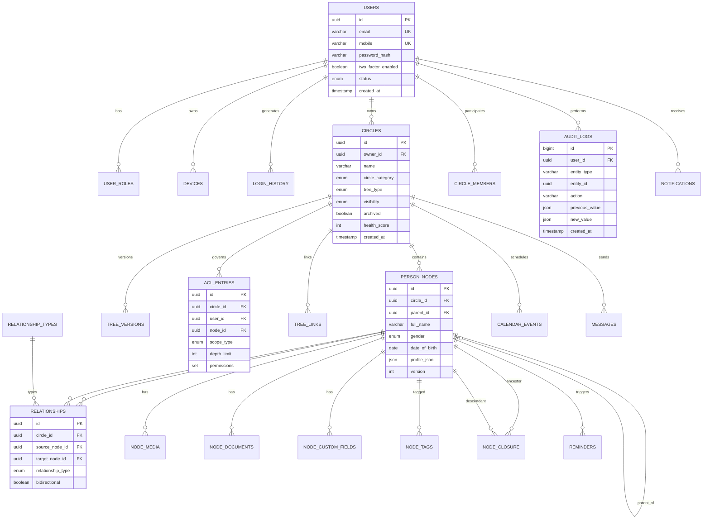

# MyAaptha — Entity Relationship Diagram

## Conceptual ER (Mermaid)

## Relationship Cardinality Notes

- **Users ↔ Circles:** Many-to-many via `circle_members` with role per membership.
- **Person nodes:** Self-referential `parent_id` plus explicit `relationships` for non-parent edges (spouse, friend, colleague).
- **Node closure:** Materialized transitive closure for O(1) ancestor queries at scale.
- **Tree links:** Many-to-many between circles when spouses belong to different trees.

## Index Strategy

| Table | Index | Purpose |
|-------|-------|---------|
| person_nodes | (circle_id, parent_id) | Child enumeration |
| person_nodes | FULLTEXT(full_name) | Name search |
| node_closure | (ancestor_id, depth) | Subtree queries |
| relationships | (source_node_id, type) | Kinship traversal |
| acl_entries | (user_id, circle_id) | Permission lookup |
| audit_logs | (entity_type, entity_id, created_at) | History timeline |
