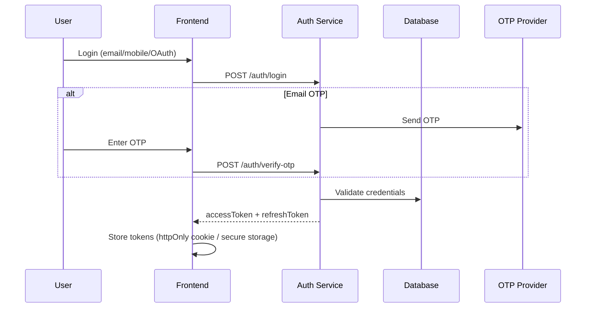
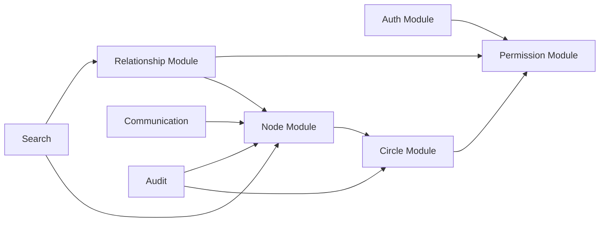

# MyAaptha — High-Level Design (HLD)

## 1. Purpose

Define major subsystems, data flows, and interfaces for MyAaptha without implementation detail.

## 2. Actors

| Actor | Description |
|-------|-------------|
| Super Admin | Platform-wide configuration, tenant oversight |
| Admin | Organization-level administration |
| Owner | Full control of owned circles |
| Editor | Create/edit nodes within granted scope |
| Viewer | Read-only access |
| Guest | Limited invited access |
| Anonymous | Public tree viewing only |

## 3. Core Use Cases

### 3.1 Authentication

### 3.2 Circle & Tree Management

- Create circle with type (Family, Office, Custom…)
- Add root node or import template
- CRUD nodes with profile attributes
- Define typed relationships (Father, Colleague, Custom…)
- Merge duplicate profiles; split/clone/archive trees
- Version snapshots with diff & rollback

### 3.3 Relationship Engine

Input: directed graph of typed edges between person nodes.

Output:
- Computed kinship label (e.g., Cousin via path A→Father→Brother→Son)
- Blood vs in-law vs step classification
- Relative distance (generational & collateral)
- Maternal / paternal branch tagging

Algorithm: BFS/DFS path finding with relationship composition rules stored in `relationship_rules` table.

### 3.4 Spouse Tree Linking

When spouse relationship is created between nodes in different circles:
1. Create **tree_link** record
2. Mark shared children as common descendants in both trees (read-only in linked tree unless permitted)
3. Sync visibility per ACL

### 3.5 Permission Model

**Two layers:**
1. **Role** (Owner, Editor, Viewer…) — coarse
2. **ACL entry** — scope: TREE | BRANCH | NODE | DEPTH | LEVEL

Permissions: VIEW, EDIT, DELETE, MOVE, CREATE_CHILD, CREATE_PARENT, INVITE, EXPORT, PRINT, SHARE, TRANSFER_OWNERSHIP

Resolution order: deny > explicit grant > role default > visibility rule.

### 3.6 Tree Visualization

Frontend renders hierarchical layout:
- Parents top, children bottom, siblings same row, spouses adjacent
- Color: male blue, female pink, unknown gray
- Border: current user green, owner gold, editor orange, viewer gray, selected purple

Backend returns paginated subgraph with layout hints (generation level, spouse pairs).

## 4. Module Interaction

## 5. API Surface

| Type | Base Path | Usage |
|------|-----------|-------|
| REST | `/api/v1/*` | CRUD, commands, file upload |
| GraphQL | `/graphql` | Flexible tree queries, dashboard |
| WebSocket | `/ws` | Live collaboration, notifications |
| OpenAPI | `/swagger-ui.html` | Documentation |

## 6. Data Stores

| Store | Data |
|-------|------|
| MySQL | Users, circles, nodes, edges, ACL, audit, events |
| MinIO | Photos, documents, exports |
| Redis | Sessions, rate limits, cache |
| Local FS | Dev-only file fallback |

## 7. Non-Functional Requirements

| NFR | Target |
|-----|--------|
| Availability | 99.9% |
| API latency (p95) | < 300ms reads, < 800ms writes |
| Concurrent users | 10k+ per region |
| Nodes per tree | 100,000+ |
| RPO / RTO | 1h / 4h |
| Compliance | GDPR-ready data export/delete |

## 8. Mobile & Offline

- Local SQLite cache (Drift/Hive) on Flutter
- Sync queue with conflict resolution (last-write-wins + manual merge UI)
- Biometric unlock for stored refresh token

## 9. PWA

- Next.js `next-pwa` service worker
- Offline dashboard & cached tree snapshots
- Push via Web Push API
