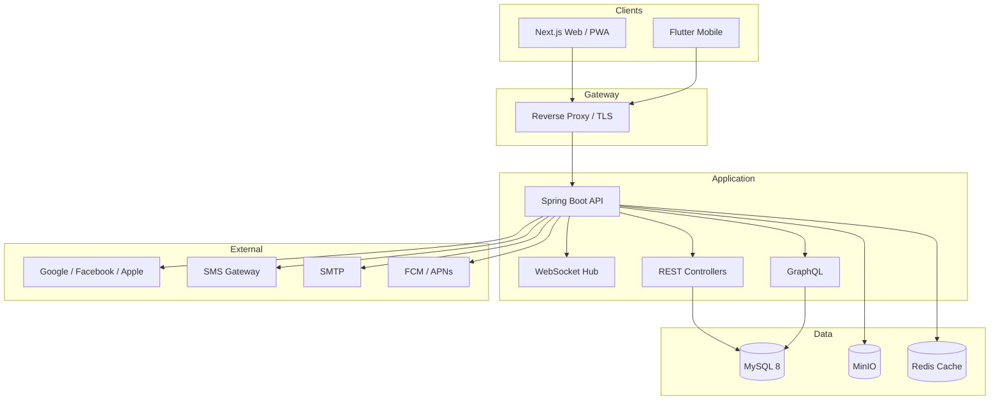
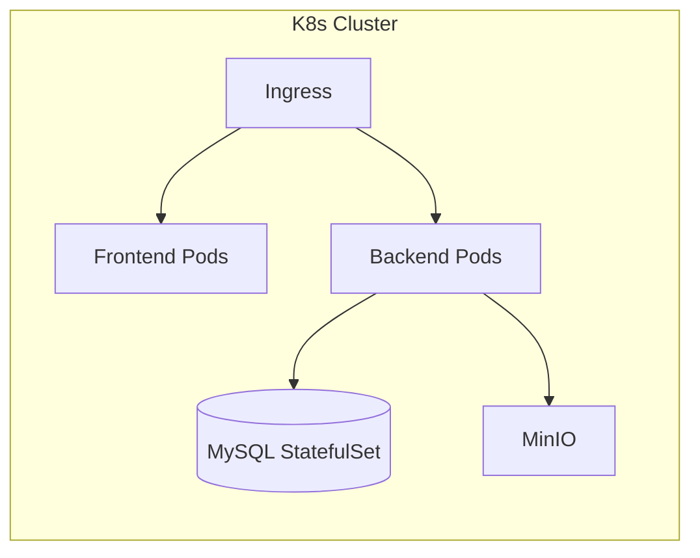

# MyAaptha — System Architecture

## 1. Overview

MyAaptha is a multi-tier, modular enterprise platform for relationship network management. Users create **Circles** (trees) with unlimited nodes and depth. A **Relationship Engine** infers kinship paths; an **ACL engine** governs fine-grained permissions at tree, branch, and node levels.

## 2. Architecture Style

**Modular Monolith** (Phase 1) with clear bounded contexts, designed for future extraction into microservices:

| Module | Responsibility |
|--------|----------------|
| Identity & Auth | Users, OAuth, OTP, 2FA, devices, sessions |
| Circle & Tree | CRUD, merge/split/clone, templates, versioning |
| Node & Profile | Person nodes, media, documents, custom fields |
| Relationship | Typed edges, inference engine, spouse linking |
| Permission | RBAC + ACL, visibility rules |
| Communication | Multi-channel messaging, filters |
| Search | Full-text, graph, AI-assisted |
| Notification | Email, SMS, push, in-app |
| Audit | Change log, rollback |
| Analytics | Dashboard, reports, graph metrics |
| AI (optional) | Suggestions, NL search, chat assistant |

## 3. Logical Architecture

## 4. Deployment Topology

- **Tomcat:** Embedded in Spring Boot JAR (production WAR deploy optional).
- **Horizontal scaling:** Stateless API pods behind load balancer; WebSocket sticky sessions or Redis pub/sub.
- **CDN:** Static assets & PWA service worker from frontend build.

## 5. Security Layers

1. TLS termination at ingress
2. JWT access + refresh token rotation
3. Spring Security filter chain (CSRF for cookie flows, stateless API)
4. Rate limiting (Bucket4j / gateway)
5. Input validation, parameterized queries (JPA)
6. XSS headers, Content-Security-Policy
7. Audit trail on all mutations
8. Encryption at rest for sensitive fields (AES-256)

## 6. Scalability (100k+ nodes)

- **Adjacency list + closure table** for efficient ancestor/descendant queries
- **Lazy loading** & pagination for tree UI
- **Virtual scrolling** on frontend (React Flow + viewport culling)
- **Read replicas** for reporting/search
- **Caching:** Redis for session, hot tree metadata, permission resolution

## 7. Integration Points

| Integration | Protocol |
|-------------|----------|
| OAuth providers | OAuth 2.0 / OpenID Connect |
| Mobile push | FCM, APNs |
| File storage | S3-compatible MinIO API |
| Real-time | STOMP over WebSocket |
| Import/Export | REST multipart, async jobs |

## 8. Observability

- Structured logging (JSON)
- Micrometer + Prometheus metrics
- Health checks: `/actuator/health`
- Distributed tracing ready (OpenTelemetry hooks)

## 9. Plugin Architecture (Future)

SPI-based plugin loader for:
- Custom relationship type providers
- Import/export adapters
- Notification channel adapters

Core remains stable; plugins register via `META-INF/services`.
