# MyAaptha Corporate Project Handbook

Version 1.4 · 20 October 2026 · Internal engineering baseline

## Contents

- 01 Executive overview and document control
- 02 Architecture and technical boundaries
- 03 Product capabilities and synchronization
- 04 Roles, authorization and user journeys
- 05 Authentication, privacy and security
- 06 Profile, settings and timeline workflows
- 07 Relationships, contacts and circle workflows
- 08 Messaging, media and notifications
- 09 Trust, health, finance and AI workflows
- 10 Use-case catalog and acceptance scenarios
- 11 Data architecture and relationship model
- 12 API contracts and integration examples
- 13 Deployment, configuration and operations
- 14 Quality assurance, evidence and release acceptance
- 15 Known limitations, decisions and maintenance
- 16 Source inventory, graphs and references
- 17 Current engineering changes and acceptance boundaries

# 01 Executive overview and document control

**MyAaptha | Corporate project handbook**  
Version 1.4 · Source snapshot 20 October 2026 · Internal engineering and business handover

MyAaptha combines relationship networks, private personal records, community communication and assisted organization in a shared account workspace. Browser and Flutter clients use the same Spring Boot API and PostgreSQL persistence. A separate Python service supplies deterministic ranking, duplicate detection and reviewable graph suggestions; selected backend features can also use configured external AI providers.

This package is intended for product owners, engineers, QA, security reviewers and operations teams. It describes the active implementation, identifies dependencies and provides editable diagrams and repeatable inventories. It does not certify a production deployment or legal compliance.

| Control | Value |
|---|---|
| Authoring basis | Active source, common Flyway migrations, recent feature and validation records |
| Application | MyAaptha; repository directory CircleNet |
| Status | Engineering baseline; organization approval and document owner to be assigned |
| Source counts | 39 Java controller files; 229 extracted HTTP mappings; 28 web pages; 67 migration-declared tables |
| Distribution | Internal; contains structural information, no real customer records or credentials |
| Maintenance | Regenerate inventories after schema/route changes; review narrative at each release |

**Evidence hierarchy:** executable source and migration files take precedence over historical manuals. Dated test reports are historical evidence, not a fresh test run. Planned infrastructure and performance targets are explicitly distinguished from observed behavior. Example names and records are fictitious.

**Active scope:** `backend/spring-boot-app`, `frontend/nextjs-app`, `mobile/flutter-app`, `ai/agent-service`, `infrastructure`. Older top-level MySQL starter implementations are reference material. The previous user/admin manuals contain aspirational items; do not infer social sign-in, offline mode, biometrics, unlimited circles or branch ACL from those manuals alone.

# 02 Architecture and technical boundaries

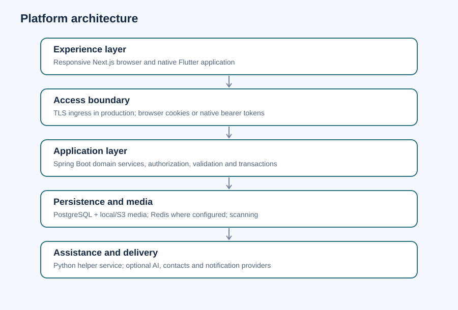

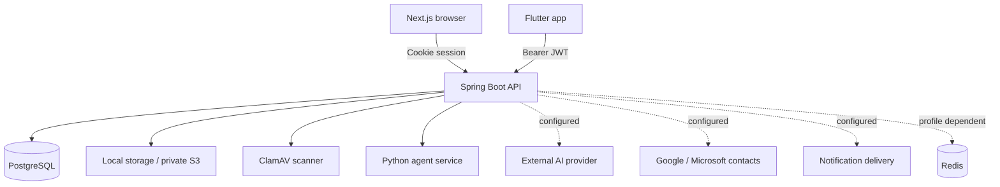

| Component | Responsibility | Source |
|---|---|---|
| Next.js 15 / React 19 | Routes, accessible information controls, responsive cards, cookie-session client | `frontend/nextjs-app` |
| Flutter | Native screens, typed HTTP integration, lifecycle refresh, device capabilities | `mobile/flutter-app` |
| Java 21 / Spring Boot 4.0 | Authentication, domain rules, owner checks, persistence, media and integrations | `backend/spring-boot-app` |
| PostgreSQL / Flyway | Relational persistence and versioned schema evolution | backend resources `db/migration/common` |
| Python / FastAPI | Candidate ranking, duplicate detection, insights, enrichment, contact organization | `ai/agent-service/src/ai_service` |
| Deployment tooling | Local lifecycle, container builds, Compose/Kubernetes templates, release gates | `infrastructure` |

The backend is a modular application, not a separately deployed microservice per business domain. Controllers expose contracts; services apply business rules; repositories/JDBC persist state. The Python helper is a separate process. Internal AI helper endpoints must be restricted at the network boundary: its route definitions do not establish the browser's account authorization model.

**Trust boundaries:** client to API; API to database; API to object storage/scanner; API to external providers; operator to secrets and deployment tooling. Authorize access before fetching protected resources. Profile image GET routes are explicitly public in the security configuration; this exception must not be generalized to chat attachments or private documents.

# 03 Product capabilities and synchronization

| Capability | User value | Contract / source | Delivery qualification |
|---|---|---|---|
| Profile | Personal, address, education, employment and social details | `/api/profile` | Saved overview; section editing; latest-record merge |
| Relationship tree | Organize family and other relationship links | `/api/network`, people APIs | Owner-scoped data and relationship anchors |
| Address book | Import and review contacts | `/api/address-book` | Provider OAuth requires credentials; device permissions apply |
| Timeline | View milestones newest first; add or edit an event | `/api/timeline/events` | Shared saved-event API; client composition of derived milestones |
| Circles and messages | Group and direct conversation | network and chat APIs | Membership checks; read, edit and deletion rules |
| Diary / social | Record and share memories under visibility controls | `/api/social` | Distinct from timeline overrides |
| Finance | Review transactions and monthly summaries | `/api/finance` | UTC month handling across clients |
| Health | Store reports and request optional analysis | `/api/health` | Manual entry is independent; external analysis requires deployment enablement and per-report consent |
| Trust center | Follow role models; designate trusted people; emergency access | `/api/trust` | Two independent approvals and time limits |
| Settings | Discovery, notifications, workspace and account preferences | `/api/settings` | Storage limits come from server policy |
| AI workspace | Ask for assistance and review proposals | `/api/ai` | Consent/preferences and approval boundaries |
| Administration | Security, storage levels, moderation and global catalogs | admin/security and domain controllers | Server role and service checks |

**Synchronization contract:** PostgreSQL is authoritative for persisted account data. Web uses its browser-session transport; Flutter uses bearer tokens and refresh. Refresh on relevant lifecycle transitions and after successful mutations. Equivalent behavior does not require identical layouts. The source-derived endpoint appendix identifies both transports' shared resources.

There is no evidence here of continuous real-time replication or complete offline conflict resolution. Polling/fetch, focus/resume and explicit refresh can leave a short stale-view interval. Profile sections merge against the latest fetched record to preserve other sections; concurrent writes within the same section are not guaranteed conflict-free. A full feature parity certification requires a release-by-release screen/contract matrix.

Native profile photo/gallery controls now use the shared profile API; the web timeline's parent-details interaction remains a client-specific behavior. Mobile-width browser screenshots test responsive web, not a native installed device. Native HTTP regression evidence validates the API client; APK compilation does not prove store readiness or every device behavior.

# 04 Roles, authorization and user journeys

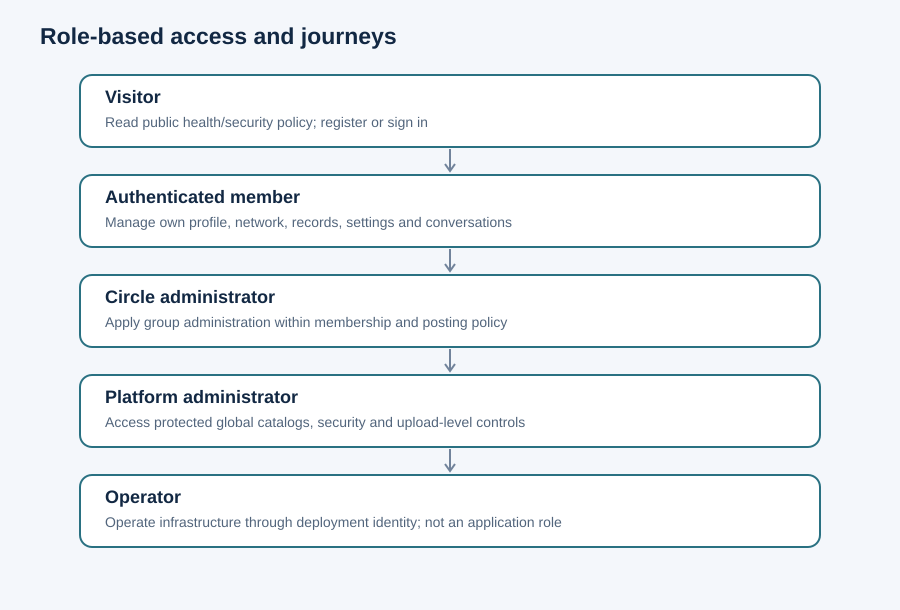

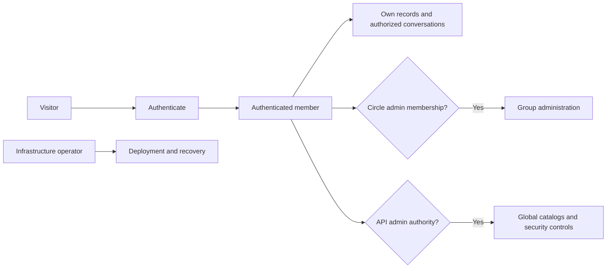

Application admin authority, circle admin membership and an infrastructure operator's permissions are different scopes. Do not assume an organizational tenant role hierarchy from the earlier generic admin manual. Consult `platform/config/SecurityConfig.java` and each service for actual checks.

| Actor | Main flow | Guard / exception |
|---|---|---|
| New member | Register → authenticate → complete profile → add relationships → configure discovery | Validation, credential policy and session checks |
| Returning member | Sign in → dashboard → chosen personal workspace → save → refresh | Expired session refresh or sign in again |
| Circle member | Open permitted circle → fetch conversation → post if allowed | Admins-only posting can deny ordinary members |
| Circle admin | Review group → manage permitted settings → moderate eligible message | Delete-for-all remains time/read constrained |
| Star Member | Receive emergency request → approve/reject independently | One approval does not grant access |
| Platform admin | Authenticate → pass configured security checks → inspect admin workspace | Generic mutation routes may require admin; ownership still applies |
| Operations engineer | Read release gates → configure environment → validate → deploy → monitor | Deployment identity, backup and approval are external controls |

**Authorization sequence:** reject invalid/expired authentication; verify route-level role; verify resource ownership or membership; validate action eligibility; execute within the required transaction; return only permitted fields. Hiding a button is presentation, not authorization.

# 05 Authentication, privacy and security

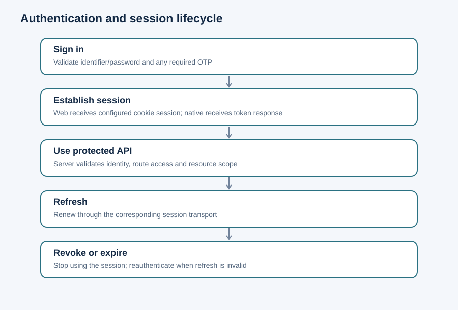

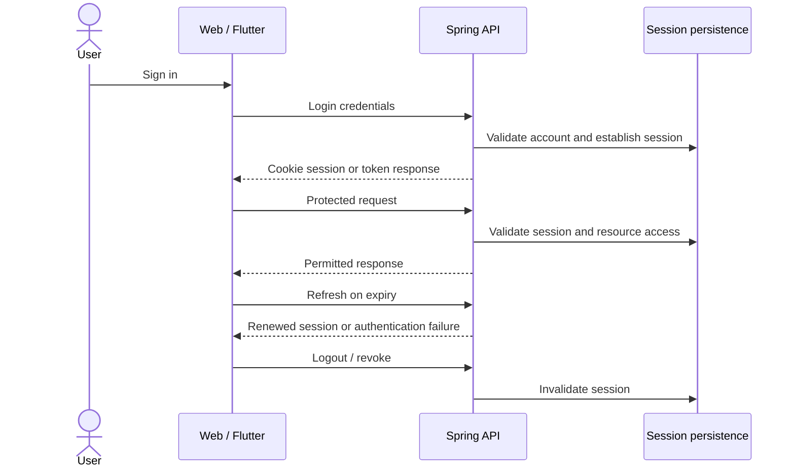

The API uses BCrypt password hashing and JWT-based stateless request authentication with persisted session/refresh controls. Native `/api/auth` and browser `/api/web-auth` have different transport semantics; do not move browser tokens into persistent JavaScript storage as a documentation shortcut. The login DTO accepts `identifier`, compatibility `email`, `password` and optional six-digit `otpCode`.

Spring's standard CSRF feature is disabled for the JWT application; the browser-cookie boundary uses its own origin/header checks. Review that filter and production origin configuration together. Security headers include CSP restrictions, referrer controls and HSTS. CORS and TLS need deployment-specific configuration.

Public registration, sign-in/refresh/logout/revoke, policy, callback and health routes are deliberate exceptions. Profile media and notification unsubscribe have specific public route exceptions. Most APIs require authentication; global administration routes require admin authority; personalized services additionally enforce owner/membership restrictions.

**Data classification:** credentials and session secrets are restricted; contact, health, finance and private messages are confidential; public profile media is publicly retrievable by its route policy; operational metrics and schema metadata are internal. Never include actual account exports, tokens, provider secrets or signed URLs in this handbook.

**Review checklist for a release:** cross-account denial, group membership changes, token revocation, cookie-origin rejection, protected attachment access, upload scanning failures, abuse-report authorization, sensitive-field minimization and audit retention. These are verification obligations, not a claim of universal certification.

# 06 Profile, settings and timeline workflows

**Profile:** display saved values by default. An Edit action opens the corresponding section form; Save updates that section against a newly fetched profile; Cancel returns to the saved overview. Invalid image URLs fall back to initials. Photo upload validates its own smaller limit; general storage limits must not be substituted for the photo policy.

**Settings:** fetch account preferences and upload policy; compute storage percentage from used bytes and allowance; show usage in a circular indicator with capacity and per-file limit below. Clamp the displayed ring to a valid range while reporting actual usage accurately. Administrators can assign configured upload levels; clients must not hardcode entitlements.

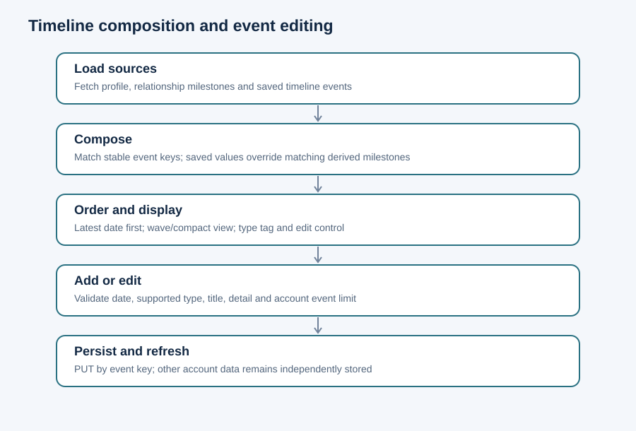

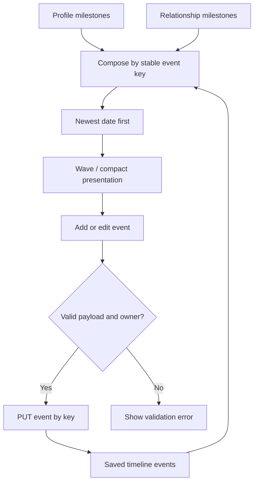

| Rule | Implemented behavior |
|---|---|
| Types | Birth, Family, Remembrance, Education, Marriage, Employment, Other |
| Colors | Blue birth/family; red remembrance; purple education; pink marriage; amber employment |
| Stable keys | `profile-birth`, `profile-education`, relation-based birth/death/marriage keys |
| Saved event scope | Composite `(user_id, event_key)` identity |
| Key validation | Letters, numbers, underscore and hyphen; 1–100 characters |
| Date | Valid ISO date; storage is VARCHAR(10), validated by LocalDate |
| Content | Nonblank title ≤200; detail ≤2,000 characters |
| New event ceiling | 500 saved events per user; existing event updates remain possible |
| Delete | Owner-scoped DELETE removes a saved event or override; source milestones remain intact |

An education year is displayed using a December 31 date convention; this is not evidence of the actual graduation day. Editing a derived milestone creates/updates a timeline override and does not alter the source profile or relationship. Source records can therefore intentionally differ from a customized timeline label.

# 07 Relationships, contacts and circle workflows

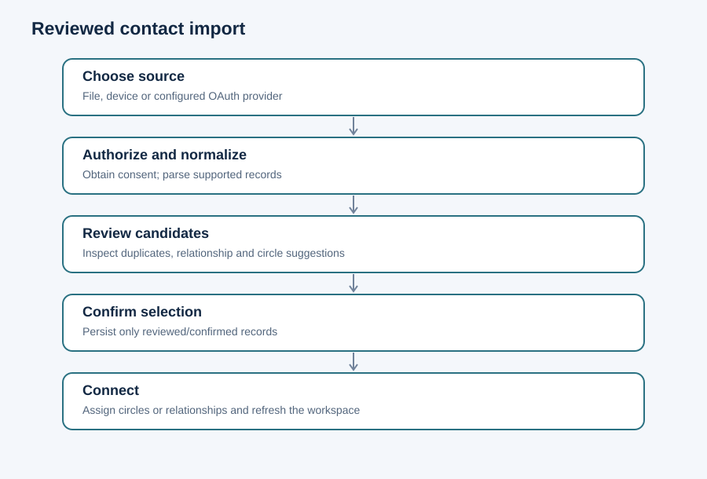

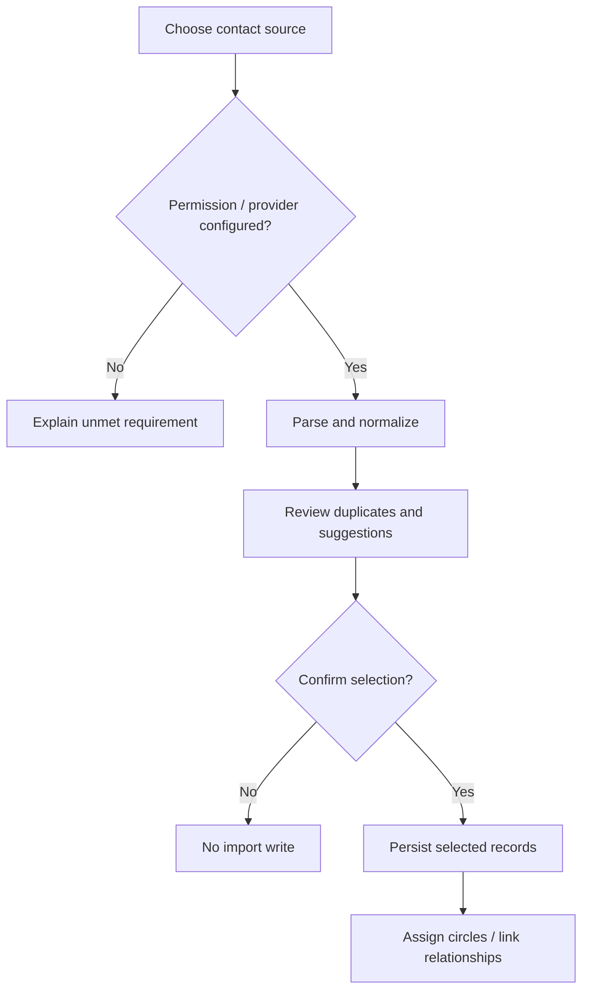


**Member workflow:** add a managed person or import a contact → review identity and contact fields → choose relationship and anchor → save → inspect the tree → correct ambiguous links. A managed person record is not automatically a registered login account. Keep `users`, personal people records and relationship edges conceptually distinct.

**Contact import:** choose a supported file/device/provider → obtain permission or OAuth consent → parse and normalize → inspect duplicates and suggestions → confirm selected entries → persist → optionally assign suggested circles. AI organization produces reviewable suggestions; it is not permission to silently merge identities. Google/Microsoft OAuth credentials, redirect URLs and outbound connectivity are configuration prerequisites.

**Relationship example:** Asha adds Ravi as a parent, anchored to herself, then adds Meera as a sibling under the correct shared parent context. A connection label depends on direction and anchor; reversing an edge can change its meaning. Review dates independently before deriving birth or remembrance milestones.

**Circle workflow:** create or select a permitted group → configure membership/admins/posting policy → fetch conversation → post if permitted → inspect read/message information → moderate according to server rules. Membership is the security boundary; a UI link does not grant access.

**Data quality controls:** avoid treating the same email/phone as conclusive identity without human review; preserve original import context; inspect duplicate candidates; confirm anchors; keep private contact details out of people-discovery cards. Role-model discovery showing generated-looking usernames may reflect existing test/generated account records; labels alone do not prove an account is a real person or endorsed role model.

# 08 Messaging, media and notifications

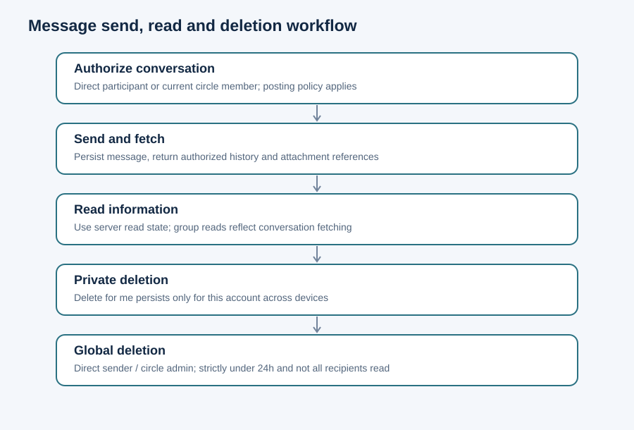

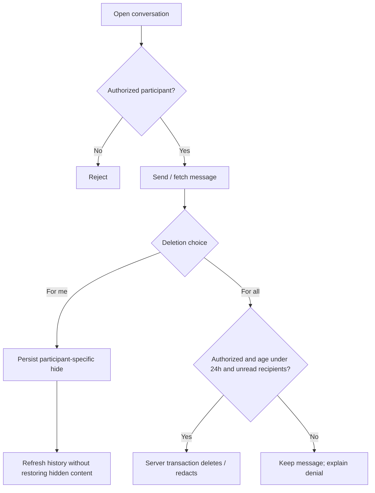

Delete-for-me is private and persisted across devices. In direct conversations only the sender can delete for all. In circles only current circle admins can delete for all, including another member's post; ordinary members cannot globally delete their own group post. Eligibility expires when all recipients have read or 24 hours elapse. Hidden read receipts do not erase stored direct read state. Group reads currently reflect conversation fetch, not per-message viewport acknowledgement.

Hidden markers allow cursor history merging to avoid restoring privately deleted content. Search, saved messages, unread counts and conversation previews exclude private deletion. Attachment access and forwarding reject hidden direct-message sources. Locking/transactions enforce eligibility against concurrent reads and edits.

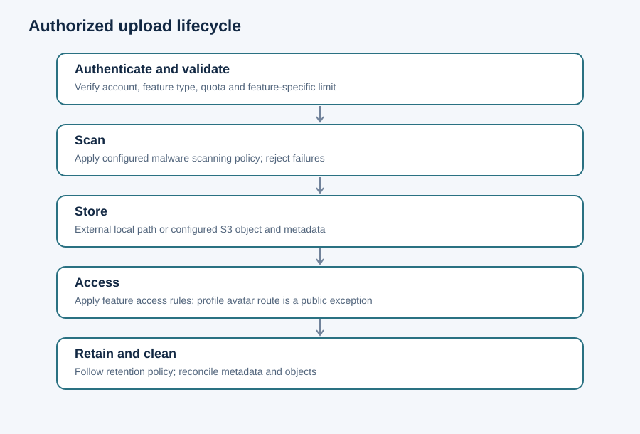

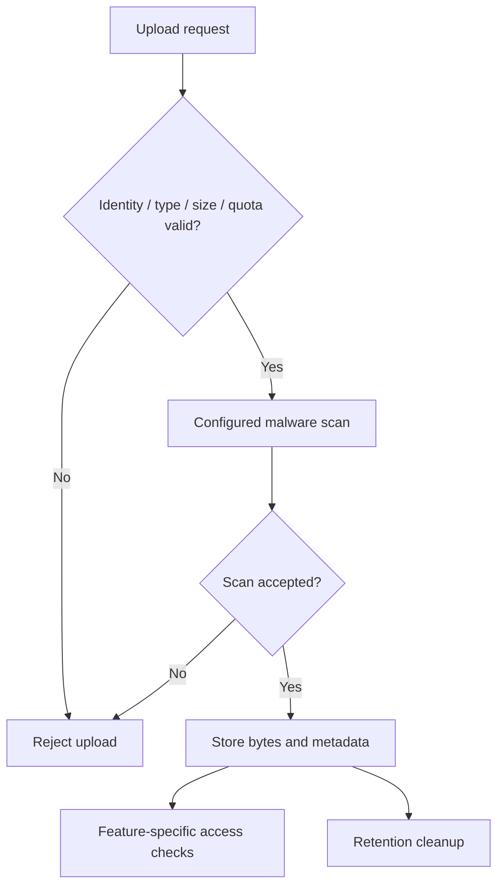

**Upload lifecycle:** authenticate → check feature-specific size, quota and allowed type → validate content → scan under configured policy → store outside the application package or in configured object storage → record metadata → authorize later access → retention cleanup removes eligible media. General multipart configuration allows 25 MB per file; profile policy is smaller (5 MB). Request/container/gateway limits are separate controls and must be checked together. Scanner and storage failures must not be presented as successful persistence.

**Notification lifecycle:** an application event produces a recipient notification; preferences and delivery configuration govern channels; the dispatcher attempts configured delivery and records result/retry handling. The default dispatcher interval is five seconds. A stored in-app notification does not prove external SMS/email/push delivery. Device registration, unsubscribe links and provider configuration require separate validation.

# 09 Trust, health, finance and AI workflows

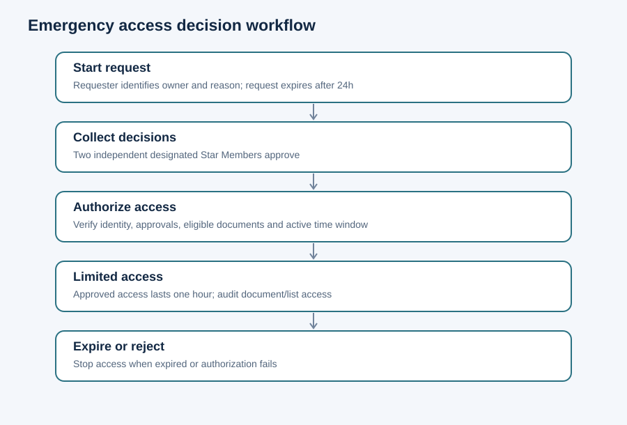

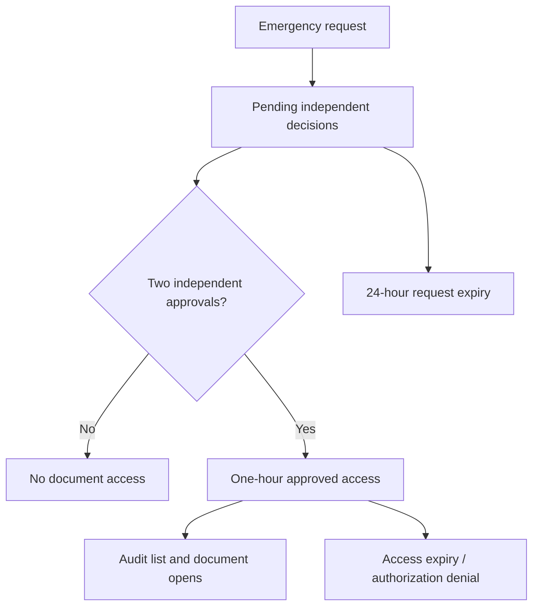

Two distinct designated Star Members must approve emergency access. Unrelated users and a single approval must remain denied. List views, decisions and document opens produce emergency audit events. Multi-channel owner alerting is an operational requirement requiring configured providers; do not infer it from the presence of the emergency API.

**Health use case:** member uploads a report → API validates access and file policy → store report → member supplies per-report processing consent and requests analysis only if enabled/configured → show interpretation with provenance and limitations → member reviews and can remove the report through authorized controls. Analysis is assistance, not a clinical diagnosis or an established regulatory approval.

**Manual health entry:** web/native support multiple named measurements and units, optional reference ranges, collection date, notes and an optional owned diary link. API validation rejects missing values, future dates, non-finite values and inverted reference bounds. Stored limits are shared: report/lab 200, metric 120, unit 40 and notes 1,000 characters. Failed client saves preserve drafts; busy controls prevent concurrent clicks. Unknown network outcomes do not have a server idempotency guarantee. Optional external analysis defaults off and uses a separate consent path. See [current health-entry contract](../launch-board/HEALTH-MANUAL-ENTRY-2026-10-18.md).

**Finance use case:** import or enter supported transaction data → inspect parsed values → persist account-owned transactions → calculate monthly summaries in the shared UTC convention → correct incorrect classification → refresh browser/native summaries. Example: a fictitious expense of 1,250 on 2026-10-01 belongs to the October UTC reporting period; currency and parsing assumptions must be explicit in import validation.

**AI use case:** fetch preferences/consent → submit permitted context → receive explanation or proposed action → inspect proposed change → approve or reject through the appropriate approval API → execute only after the server validates decision, actor and action scope → inspect resulting data. Not every response requires execution; suggestion endpoints do not imply autonomous writes.

The Python helper's ranker uses normalized fields and similarity; duplicate detection compares phone/email and similar names; family insights and enrichment require explicit consent in their request contracts. Contact organization uses rules/aliases. These deterministic endpoints do not establish a trained proprietary model. External LLM-backed help/health functionality is a separate configured backend integration. Approvals, execution and history have dedicated Java controllers.

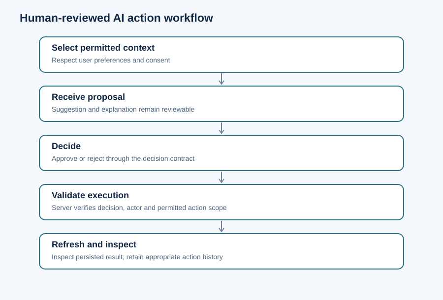

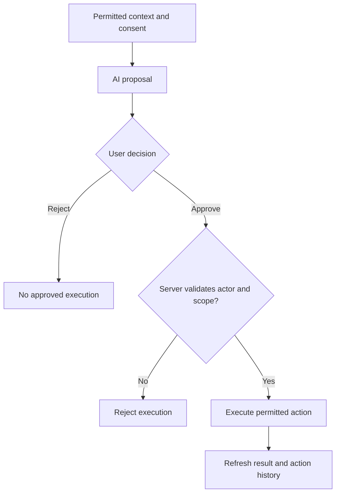

# 10 Use-case catalog and acceptance scenarios

| ID | Actor / trigger | Main result | Alternate or denial path | Acceptance evidence to capture |
|---|---|---|---|---|
| UC-01 | Visitor registers | Account eligible for sign-in | Invalid/duplicate data rejected | Registration validation and credential policy |
| UC-02 | Member edits education | Saved overview reflects section change | Cancel preserves saved values | Other profile sections remain unchanged |
| UC-03 | Member adds timeline event | Event visible in latest-first order | Invalid date/type/title rejected | Reload and native fetch show saved value |
| UC-04 | Member overrides birth milestone | Timeline label/date overridden | Source profile stays independently stored | Matching stable key and source comparison |
| UC-05 | Member imports contacts | Reviewed entries persisted | Missing consent/provider error/duplicate warning | Confirmed selection, no silent merge |
| UC-06 | Member links a relative | Tree and milestone context update | Invalid anchor or inaccessible person denied | Direction and owner isolation |
| UC-07 | Circle member sends message | Authorized group sees message | Admin-only posting denies ordinary member | Membership and posting-policy tests |
| UC-08 | Member deletes for me | Sender's history hides entry | Other participant retains entry | Cross-device reload, search and attachment access |
| UC-09 | Sender/admin deletes for all | Eligible message disappears/redacts | Read/time/role constraint denies | Boundary at 24h, race with read acknowledgement |
| UC-10 | Member uploads report | Stored authorized metadata/media | Quota/type/scanner failure denied | No unscanned successful upload |
| UC-11 | Stars approve emergency | Limited access after two approvals | One approval/unrelated actor/expiry denied | Audit trail and time-window checks |
| UC-12 | Member approves AI proposal | Validated approved change executes | Rejection or changed scope blocks | Decision/actor binding and resulting state |
| UC-13 | Admin changes upload level | API returns updated entitlement | Non-admin denied | Server and both-client policy refresh |
| UC-14 | Operator restores backup | Isolated restored environment validated | Failed checks prevent cutover | Actual measured RPO/RTO and integrity report |

**Example end-to-end scenario:** Asha signs in, saves education, adds a graduation event, imports reviewed contacts, opens a family circle and posts a reunion message. Her Flutter client refreshes the saved event and the same account preferences. Ravi, using another account, must not fetch Asha's private event list or health report by changing an identifier. Record API responses, account isolation, refresh behavior and UI screenshots separately.

**Boundary scenarios:** expired refresh token; two edits to different profile sections; same-section concurrent edits; invalid leap date; 501st new timeline row; edited existing row at the limit; removed circle member requesting old attachments; all recipients read immediately before deletion; failed malware scan; exhausted storage; provider outage; emergency expiry; missing external AI consent.

# 11 Data architecture and relationship model

The physical system uses PostgreSQL migrations. `users` represent login identities; personal/managed people records and relationship edges represent the member's network; circles and membership tables represent communication scope. Other domains attach account-owned settings, sessions, media, records, notifications, AI decisions and trust events.

**Physical versus logical relationships:** the ER files below are extracted from explicit migration `REFERENCES` clauses. Ownership columns without a declared FK are business relationships and must not be shown as database-enforced constraints. Optional references may be zero-or-one; the overview deliberately uses conservative optional cardinality. Uniqueness and nullability details are in the migration inventory.

The schema appendix is a source-derived DDL reference, not a live `pg_catalog` export. It tracks CREATE TABLE, ADD/DROP COLUMN and retains ALTER/constraint statements for review. Complex conditional SQL, renamed structures or altered definitions must be reconciled against PostgreSQL metadata before treating it as a certified deployed schema. Runtime database access was not required to prepare this package.

**Retention and integrity:** follow documented media retention and privacy workflows; do not assume row deletion removes every external object. Timeline ownership FK has ON DELETE CASCADE. Session, audit and emergency records have independent purposes and retention requirements. Validate backups jointly with object storage and migration version.

# 12 API contracts and integration examples

The source-derived appendix enumerates method/path/controller for active Java mappings. It is a route catalog, not a complete OpenAPI contract: body validation, query parameters, media types and error envelopes remain defined in controller DTOs/services. AI helper routes are separately cataloged. Check `SecurityConfig.java` in declaration order before assigning a permission label to a path.

**Native sign-in example (fictitious credentials):**

```http
POST /api/auth/login
Content-Type: application/json

{"identifier":"asha@example.invalid","password":"<user-supplied-password>"}
```

Use the response's access token only through the authorized bearer transport. Browser login uses its cookie-session route and required origin/header policy. Do not assume the two login responses are interchangeable.

**Create/update a timeline event:**

```http
PUT /api/timeline/events/custom-graduation-2026
Authorization: Bearer <access-token>
Content-Type: application/json

{"eventKey":"custom-graduation-2026","date":"2026-06-15","kind":"Education","title":"Graduation","detail":"Completed a postgraduate course"}
```

The path key determines the saved event identity. GET `/api/timeline/events` returns the signed-in user's saved events ordered by date descending and key; it does not return the entire client-composed set of source milestones. Unsupported kind, invalid date or length violations return a bad request. The controller updates an existing owned key or inserts a new row. DELETE `/api/timeline/events/{key}` returns 204 and removes only the signed-in account's saved row or override; removing an override restores its source-derived display without changing profile/relationship records.

**Error handling:** 400 denotes validated bad input in the timeline contract; 401 authentication failures; 403 authorization denial where enforced; other controllers may return different statuses for missing or invalid resources. Clients should handle expiry, validation and transient integration failure separately. Do not assume an undocumented universal error envelope or blanket retry/idempotency guarantee for all POSTs.

**Contract evolution:** prefer additive changes, keep compatibility fields deliberately, validate strict JSON behavior and release clients together when contracts change. Test both cookie and bearer paths, cross-account denial and reload persistence. Timeline PUT is a stable-key update; arbitrary create/send operations may create duplicates if retried without an idempotency contract.

# 13 Deployment, configuration and operations

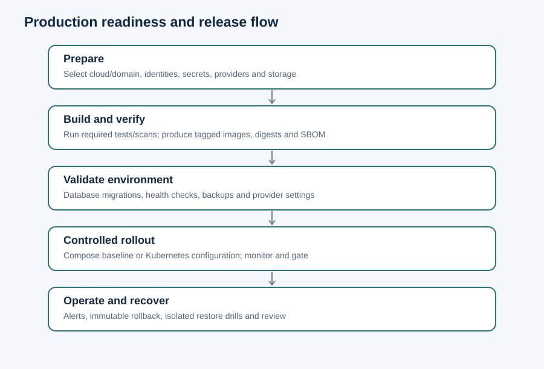

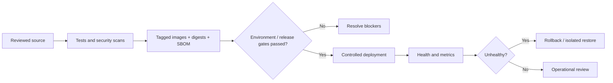

**Local preview:** run `powershell -ExecutionPolicy Bypass -File infrastructure/start-local.ps1`; `-SkipBuild` uses existing built artifacts. Stop through `infrastructure/stop-local.ps1`; the local PostgreSQL volume is retained. Canonical web preview uses port 3000; API and helper settings come from the local startup configuration. Do not start a competing Next.js dev build over a standalone preview's `.next` output.

**Production baseline:** Compose templates support a single-host TLS/Caddy deployment; Kubernetes templates provide replicas, probes, resources and autoscaling scaffolding. Managed PostgreSQL, Redis, object storage, secret manager and ingress are deployment dependencies, not proof that resources have been provisioned. Do not claim production readiness from local startup.

| Configuration group | Required review |
|---|---|
| Database | URL, credentials, profile, migration locations, connection limits, backup/PITR |
| Authentication | Random managed JWT/session secrets, lifetimes, origin/cookie policy, admin security |
| Storage | Local/S3 provider, external path/bucket, IAM, quota, scanner, cleanup schedule |
| Contacts | OAuth credentials and exact redirect URLs for enabled providers |
| AI | Helper URL, provider credentials/model policy, consent and data egress |
| Notifications | Channel/provider credentials, webhook settings, device setup and retries |
| Infrastructure | Domain/TLS, registry digest, replicas, resources, observability and rollback |
| Mobile release | Signing identity, store metadata, permission declarations and device validation |

Never promote local fallback credentials or secrets into production. Example configuration belongs in templates with placeholders; operational credentials belong in the approved secret mechanism.

The existing operations runbook states **targets**, including 99.9% monthly availability, RPO 15 minutes and RTO four hours. These are not measured guarantees. Baseline alert proposals include sustained 5xx rate, latency, database pool pressure and notification failures. Instrument the deployed system and agree organization-specific objectives before treating them as service commitments.

**Recovery workflow:** identify incident → preserve audit/log evidence → isolate affected component → revoke/rotate compromised access if needed → restore PostgreSQL into an isolated environment → validate migration version, constraints and representative domain access → reconcile media → measure recovery time and data loss → approve cutover → document follow-up. An image rollback alone cannot undo every schema/data change.

# 14 Quality assurance, evidence and release acceptance

| Layer | Required checks | Existing evidence basis |
|---|---|---|
| API | Domain tests, authorization, input validation, persistence and migration compatibility | Recent sync/timeline/backend reports |
| Web | Production build, unit/e2e/integration, keyboard and responsive checks | October 8 app-design record |
| Flutter | Analyzer, unit/widget tests, HTTP contract integration and debug build | October 8 native client record |
| Providers | OAuth callback, delivery, AI consent and outage behavior | Requires configured deployment |
| Security | Dependency/image scans, secrets, isolation, malware handling | Release tools and security docs |
| Operations | Health/readiness, realistic capacity, backup restoration, rollback | Requires deployed environment and measured drill |

Recent recorded evidence includes a passing web production build and 12 production E2E checks, Flutter analysis with no issues, 34 passing mobile tests with one opt-in live test skipped in the ordinary suite, and a separately passing native HTTP live check. These are **October 8 historical results**, not tests rerun during documentation generation. The browser route review covered 28 routes at desktop/mobile sizes; native device behavior is a separate obligation.

Earlier API and synchronization reports contain different test counts from different dates/scopes. Do not add them together as a current suite size. Consult linked evidence and rerun the release's required checks from its exact commit before sign-off.

**Release acceptance:** identify release artifact and migration set; validate both session transports; verify cross-account isolation; cover file/quota limits; verify derived and saved timeline composition; validate message deletion races; test configured providers; record accessibility and device checks; confirm secrets, backup restoration and rollout/rollback gates. Open issues require an accountable owner and a recorded acceptance or remediation decision.

# 15 Known limitations, decisions and maintenance

| Item | Impact / decision |
|---|---|
| Historical aspirational manuals | New handbook is the implementation-grounded entry point; retain old records with context |
| Configuration-dependent providers | Do not advertise delivered notifications, OAuth import or external AI without configuration tests |
| Timeline saved overrides | Owner-scoped saved-row deletion/reset; source profile/relationships remain independent; education date convention |
| Same-section concurrent profile edits | Latest merge protects other sections; no universal conflict resolution guarantee |
| Client differences | Shared API does not establish complete feature-identical web/native experiences |
| Public profile image route | Treat avatar imagery according to actual public route policy |
| Physical DDL inventory | Review raw migrations and deployed catalog for complex ALTER/conditional statements |
| Capacity/SLA | Existing targets and historic local measurements do not establish production guarantees |
| Cloud/store handoff | Infrastructure provisioning, secrets, restore drills and mobile signing remain external release gates |

**Change process:** update source and tests → add migration if required → regenerate this package → review route/data diffs → update diagrams and user scenarios → validate portable rendering and links → assign document version/approval → publish through the organization's approved channel.

**Glossary:** account = authenticated user identity; managed person = network record that may not have a login; relationship = directed/anchored connection; circle = communication/membership group; Star Member = designated trust actor; override = saved timeline value taking precedence over a matching derived key; upload level = configured storage entitlement; evidence = a dated recorded verification outcome; target = desired service behavior requiring measurement.

# 16 Source inventory, graphs and references

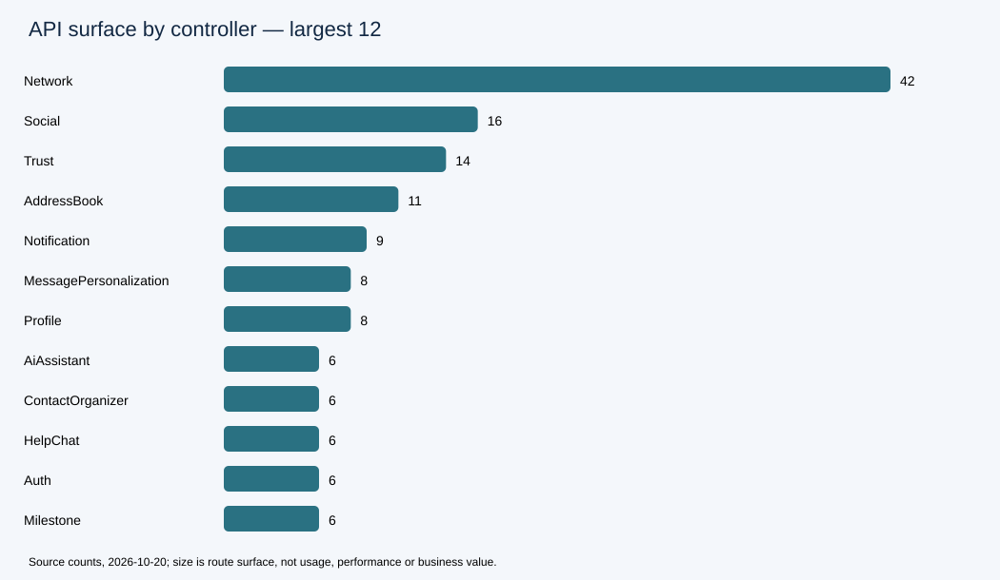

The graph counts extracted method/path mappings, including transport and administration endpoints. It measures source surface only; it does not measure demand, throughput, quality or delivery completeness.

## Web route inventory

- `/.`
- `/ai-activity`
- `/auth`
- `/circle-search`
- `/circles`
- `/contacts`
- `/dashboard`
- `/discover`
- `/feed`
- `/finance`
- `/following`
- `/health`
- `/help`
- `/messages`
- `/moderation`
- `/notifications`
- `/people/[id]`
- `/privacy`
- `/profile`
- `/recover-account`
- `/relationship-tree`
- `/reports`
- `/security-reports`
- `/session`
- `/settings`
- `/timeline`
- `/trust`
- `/verify-phone`

## Appendices

- [API catalog](api-catalog.md): Java method/path/source links and Python helper routes.
- [Data dictionary](data-dictionary.md): table declarations, added columns and ALTER history.
- [ER diagrams](er-diagrams.md): whole-system and domain-specific Mermaid relationships.
- [Machine-readable inventory](source-inventory.json): repeatable route/schema metadata.
- [Physical FK map](diagrams/physical-er.svg): standalone vector reference.

## Authoritative and supporting references

- [Project README](../../README.md)
- [Recent application design and validation](../app-design-2026-10-08.md)
- [Synchronization audit](../synchronization-2026-10-06.md)
- [Timeline API and clients](../timeline-events-2026-10-08.md)
- [Profile and storage behavior](../profile-storage-2026-10-07.md)
- [Contact import](../contact-import.md)
- [Message deletion policy](../message-deletion-2026-09-30.md)
- [Trust test strategy](../trust-center-testing.md)
- [Deployment handoff](../MYAAPTHA-DEPLOYMENT-HANDOFF.md)
- [Operations runbook and targets](../operations-runbook.md)
- [Security configuration](../../backend/spring-boot-app/src/main/java/com/myaaptha/config/SecurityConfig.java)

# 17 Current engineering changes and acceptance boundaries

This edition refreshes source-derived API/schema references to 20 October 2026 and supersedes the 10 October handbook narrative where behavior changed. Earlier dated verification is preserved as historical evidence.

| Area | Current implementation and evidence |
|---|---|
| Moderation | Admin-only status-filtered cursor queue on web/native/API; old reports remain reachable. Reporter-visible notes and cancellation behavior are explicit. V69 indexes the queue. [Workflow and role boundaries](../launch-board/MODERATION-QUEUE-2026-10-18.md). |
| Contacts | Shared native granted/limited permission boundary, review before import and no read/upload after denied permission or leaving the pending dialog. Local plugin/API checks pass; physical device acceptance remains open. [Permission matrix](../launch-board/CONTACT-PERMISSIONS-2026-10-18.md). OAuth now handles terminal failures, empty results, cancellation and consent revocation consistently across clients; [completion contract and staging limits](../launch-board/CONTACT-OAUTH-COMPLETION-2026-10-18.md). |
| OAuth storage | Pending authorizations and review results now use the configured shared state provider, encrypted Redis payloads, hashed keys, ten-minute TTL and atomic owner/provider-validated consumption. Memory remains development only; real provider/staging acceptance remains open. [Storage and rollout workflow](../launch-board/OAUTH-SHARED-STORAGE-2026-10-19.md). |
| Health | Multi-measurement manual entry, matching bounds, preserved failed drafts and disabled-by-default consent-gated analysis. [Contract](../launch-board/HEALTH-MANUAL-ENTRY-2026-10-18.md). |
| Release identity | Version 2 hashes the full standalone web bundle and API/debug APK, with a verification command. Local identities never establish production promotion approval. [Artifact scope](../launch-board/LOCAL-BUILD-IDENTITIES.md). |
| Operational authorization | Administrator-only Actuator metadata and an optional narrowly scoped metrics credential. Packaged production-profile TLS checks verified isolated PostgreSQL/Redis readiness withdrawal, retained liveness/metrics and recovery. Real collectors, alerts and live rollback remain pending; see [operational guide](../launch-board/OPERATIONAL-METRICS-2026-10-20.md). |
| Android release | Release builds require a protected owner signing identity and reject debug signing. A manual candidate workflow pins the certificate and records signature/packaging review results; synthetic-key local verification does not establish store acceptance. [Signing implementation](../launch-board/ANDROID-RELEASE-SIGNING-2026-10-20.md). |
| Recovery | Unique complete dump publication, mandatory checksum verification and nonempty-target rejection. Actual local two-row PostgreSQL drill passed; managed PITR/media/RPO/RTO remain open. [Recovery scope](../launch-board/RECOVERY-GUARDS-2026-10-18.md). |
| AI evaluation | Ten synthetic review cases and offline comparison; actual stronger-model quality acceptance remains pending and retries default off. [Rubric and workflow](../launch-board/HELP-MODEL-EVALUATION.md). |

The [viewable launch board](../launch-board/index.html) and [dated module status](../launch-board/STATUS-2026-10-20.md) distinguish fully closed local tasks from partial engineering and external acceptance. Current scope includes explicitly identified engineering additions; changed scope is disclosed rather than presented as closure of provider, staging or approval work. Saved browser edits remain separate from the latest source evidence.

The [18 October development report](../launch-board/DEVELOPMENT-2026-10-18.md) records separate backend, native, browser, build and operational checks. Do not sum different test scopes into one suite size. Physical Android/iOS acceptance, selected staging deployment, real delivery/OAuth, independent security review, policy approval, capacity and production promotion remain open. The latest recorded 5,000-user capacity run failed. No paid stronger-model call or production deployment was performed for this update. The [20 October acceptance audit](../launch-board/PENDING-ACCEPTANCE-2026-10-20.md) records the exact requirement, proposed team and next action for every open gate. Offline rollback preparation and Android signing evidence are in the [20 October report](../launch-board/DEVELOPMENT-2026-10-20.md). The [19 October continuation](../launch-board/DEVELOPMENT-2026-10-19.md) records the shared OAuth storage migration and its verification boundaries.
