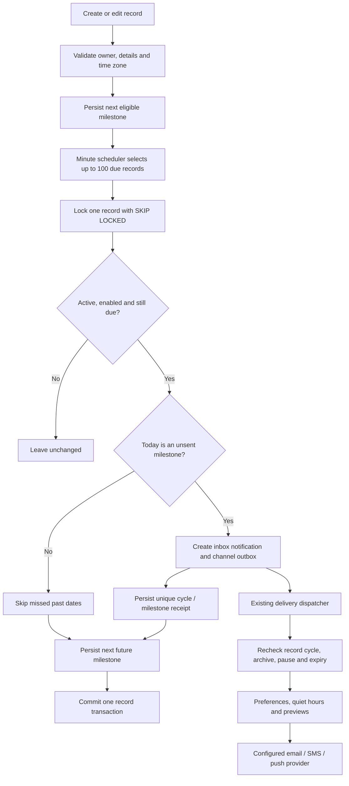
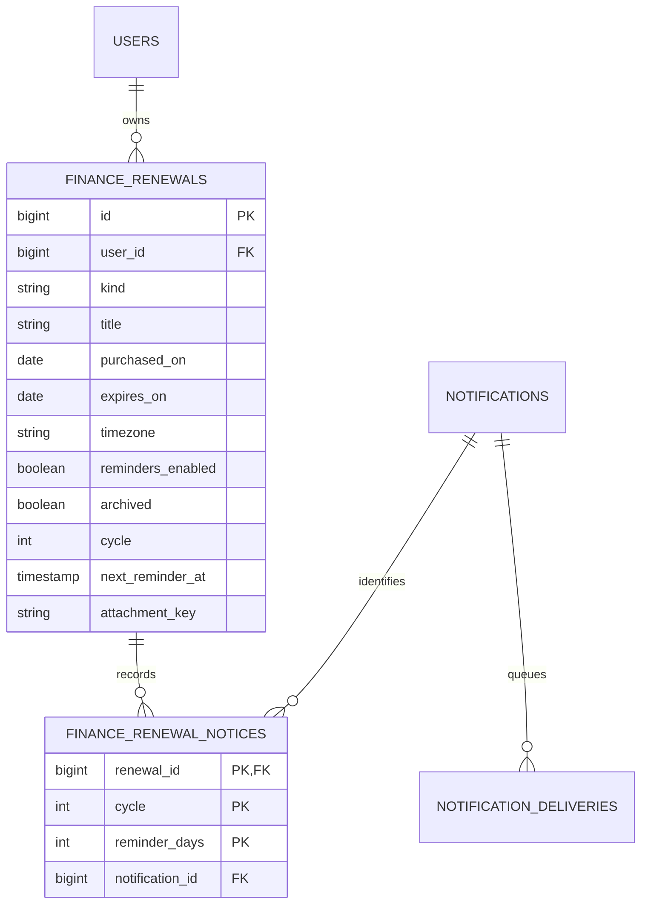

# Finance: bills, warranties and service renewals

Implemented 23-24 October 2026. This feature adds renewal planning under the existing Finance menu. The video reference could not be retrieved; implementation follows the owner's written requirements.

## User workflow

1. Open Finance, then **Bills & warranties**. On mobile, tap the Bills & warranties card.
2. Add a bill, warranty or service plan: title, expiry/due date, optional provider, invoice/reference, INR amount, purchase/start date and notes.
3. Optionally attach a PDF, JPG, PNG or WebP receipt. Existing storage quota, account upload limit, retention selection, signature validation and malware scanning apply; the maximum file size is 25 MB.
4. Keep reminders enabled and choose the time zone. Reminders are scheduled at **9am local time, 30, 15, 7, 3 and 1 day before expiry**.
5. Use **Edit** to correct details, **Renew** to choose the next expiry date, or **Archive** to stop reminders while retaining the record. Delete requires a confirmation in both clients.

Renewing does not create a financial transaction, charge a card or automatically renew a provider subscription. Payment recording remains the existing transaction workflow. A past expiry date can be kept as history; it does not generate five retrospective notifications. A maximum of 1,000 records per user bounds the collection view.

For an expiry of **31 December 2026**, reminders occur on **1, 16, 24, 28 and 30 December**, at 9am in the saved time zone. A newly created record on a milestone date after 9am is eligible on the next scheduler run. Records created between milestones start with the next future milestone.

## Shared API contract

Cookie-based web sessions and bearer-based mobile sessions use the same owner-scoped endpoints.

| Method | Path | Purpose |
| --- | --- | --- |
| GET | `/api/finance/renewals` | List the current user's records, including archive state |
| POST | `/api/finance/renewals` | Create a record; returns 201 |
| PUT | `/api/finance/renewals/{id}` | Replace editable details / renew / pause / archive |
| PUT | `/api/finance/renewals/{id}/state` | Change archive/reminder flags without overwriting saved dates or details |
| DELETE | `/api/finance/renewals/{id}` | Remove record and receipt; returns 204 |
| POST | `/api/finance/renewals/{id}/attachment` | Attach or replace multipart `file` |
| GET | `/api/finance/renewals/{id}/attachment` | Private authenticated receipt download |
| DELETE | `/api/finance/renewals/{id}/attachment` | Remove receipt; returns 204 |

```json
{
  "kind": "WARRANTY",
  "title": "Washing machine warranty",
  "provider": "Example service centre",
  "referenceNumber": "INV-2026-001",
  "amount": 24999.00,
  "purchasedOn": "2026-12-31",
  "expiresOn": "2027-12-31",
  "timezone": "Asia/Kolkata",
  "notes": "Keep the original invoice for service visits.",
  "remindersEnabled": true,
  "archived": false
}
```

Kinds are `BILL`, `WARRANTY` and `SERVICE`. Missing reminder preference defaults to enabled; missing time zone defaults to Asia/Kolkata. The response adds `id`, `daysRemaining`, `status`, `nextReminderAt`, the five `reminderDays`, and optional receipt metadata. Both client serializers explicitly omit those read-only fields from writes; the server retains its strict unknown-field validation. Archive/restore uses the state-only endpoint with `{ "archived": true }` or false so a stale card cannot revert a newer renewal date.

Foreign-owner IDs return 404 for update, deletion and receipt operations. Receipt downloads are `no-store`, use attachment disposition, and do not expose a storage key or public bucket URL. The JSON schema, lengths, amount precision, date ordering and ZoneId are validated server-side.

## Reminder workflow



Notification creation, outbox enqueue, milestone receipt and cursor advancement share the database transaction. A row lock and primary key `(renewal_id, cycle, reminder_days)` prevent duplicate milestone creation across replicas and retries. Each record is processed independently so one failure does not roll back the complete batch. Failed records remain due for retry.

Changing the expiry date starts a new cycle and recalculates reminders. Ordinary title/provider edits do not rearm an already recorded milestone. Pause, archive, deletion and a new expiry cancel pending/retry channel deliveries; the existing delivery-time guard also rejects notices from a superseded cycle. A provider call already in flight cannot be unsent. Existing inbox entries remain notification history.

Missed milestone dates during an outage are skipped, and future milestones continue; there is no retrospective notification flood. Dates follow the stored time zone, including DST. Exactly five lead times are supported; there is no additional expiry-day or overdue repeat alert.

The in-app notification is created independently of external delivery configuration. Email, SMS and push use existing channel preferences, registered devices, quiet hours, preview privacy, retry leases and configured providers. Real-device/store delivery still needs provider and device acceptance; this feature does not certify those existing release gates.

## Data relationships

Migration: `V70__finance_renewals.sql`.



The receipt key references the existing media-asset registry logically; receipt access first checks record ownership, then media expiry/deletion state. Receipt retention is separate from the renewal date. Removing or expiring a server copy does not change the user's expiry record or downloaded copies.

## Configuration and local verification

- `myaaptha.finance.renewal-reminders-enabled`: defaults to true.
- `myaaptha.finance.renewal-reminders-delay-ms`: defaults to 60000.
- The scheduler requires PostgreSQL/shared transactional state, and external delivery requires existing notification provider configuration.
- Production-provider activation, physical-device delivery and public release approval remain separate from local feature completion.

[Dated local verification report](launch-board/FINANCE-RENEWALS-2026-10-24.md): 19 focused backend tests, three native unit/widget cases, one real native/PostgreSQL/ClamAV/scheduler integration, two final responsive browser flows and two existing finance-month regressions passed. Backend, production web and Android debug builds passed; targeted native analysis reported no issues.

### Delayed external delivery

Queued email, SMS and push reminders are eligible only on their original milestone date in the saved time zone. Retries or quiet hours that cross local midnight skip the outdated countdown instead of sending an inaccurate number of days. Existing in-app history remains available. Renewal, pause, archive and deletion also invalidate queued delivery.
