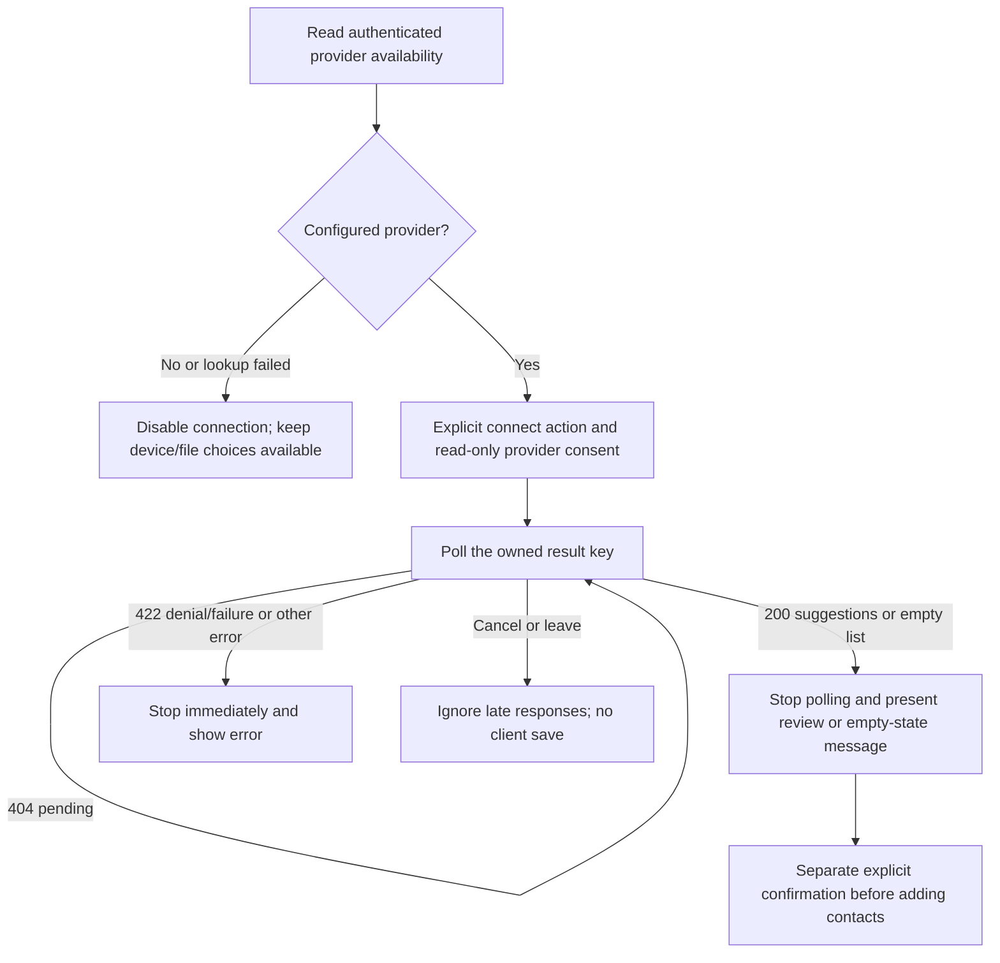

# Contact OAuth completion and client parity

18 October 2026. Local engineering for **M04.4**; real Google/Microsoft staging activation remains pending.

## Shared workflow

Web and native organizers use the existing authenticated `/api/address-book/providers` metadata. A true value means provider credentials are configured, not that provider registration, connectivity or deployment acceptance has passed. Unavailable connections are disabled. A metadata error has a retry control and does not disable file/device alternatives.

The web organizer reserves its popup during the click, before awaiting the start request, so a blocked popup does not create an unusable server authorization attempt. Results are polled from the key returned by that request. Unsolicited `postMessage` events no longer choose a result key. Polling also works when cross-origin opener isolation prevents callback messaging. Window isolation can make a popup appear closed while consent is still in progress; the client therefore uses explicit cancellation rather than inferring cancellation from `window.closed`.

Native and web retry only HTTP **404** while waiting. HTTP 401/403/422/429/5xx, transport errors and malformed results stop the flow. The native address book uses the same bounded polling helper. Organizer defaults are 150 attempts at two-second intervals; native private-book polling retains its 300-attempt limit. These are request-count bounds, not strict wall-clock deadlines including network duration.

## API compatibility and completion

| Case | Organizer result endpoint | Private address-book endpoint |
|---|---|---|
| Waiting, expired, already consumed or different owner | 404 | 404 |
| Successful suggestions | Existing array shape | Existing review object |
| No contacts | 200 empty array, consumed once | Existing review object with empty contacts |
| Provider denied or processing failed | 422 with safe message, consumed once | Existing failed-status object |

Clients also recognize older organizer failed-status objects as terminal failures, avoiding a cast error or repeated polling against a result already consumed. A callback on the wrong provider path no longer consumes the pending authorization; the correctly routed callback can still finish. State consumption remains atomic within the service instance, and another account cannot consume an owned result.

The organizer callback rechecks the account's sensitive-data/AI permission **before token exchange/contact fetching and immediately before analysis**. Revocation while the provider read is in progress stops analysis. Private address-book review remains independent of optional AI permission; granting read-only provider consent does not automatically save contacts or add relationships.

## Cancellation boundaries

Both organizers expose Cancel connection. Cancelling or leaving invalidates the client attempt; late start/results cannot reopen its UI or overwrite a newer attempt. Web closes its popup on a best-effort basis; native cannot close an external browser it does not own. Cancellation stops waiting and prevents client persistence. It does not revoke an external provider grant or guarantee interruption of server/network work already running. Server pending/results have a ten-minute access expiry. Scheduled maintenance now prunes expired pending authorizations and results every minute even if no further client requests arrive; request paths also prune expired entries. This is process-memory cleanup, not a provider-side deletion guarantee. Provider tokens are used transiently and are not stored as account credentials.

## Verification and remaining acceptance

Backend coverage includes terminal HTTP 422, ownership and one-time consumption, wrong-provider callbacks, empty completion, provider failure and consent revocation before/during provider reads. All provider exchanges use mock HTTP servers; no live provider sign-in or contact retrieval is performed.

Native coverage includes terminal/pending error classification, bounded retries, cancellation before/after a result, unavailable providers, metadata retry, empty results, legacy payloads and device-permission regression. Browser integration uses local route fixtures for availability, popup and OAuth responses; ordinary account login, isolation and no-persistence checks use the real local API.

Actual provider registrations, approved scopes/callbacks, secrets, consent/account selection and physical devices remain unverified. Pending authorization/results currently live in service memory: restart loses them, and a multi-replica staging rollout must supply validated routing/shared-state behavior before activation. Local simulations do not establish that production prerequisite. No cloud deployment, provider activation or production approval is implied.

The browser accessibility scenario exposed an existing shared theme conflict: workspace primary-button hover used a dark teal background while the pastel theme kept dark text (1.31:1 in the failing Google control). The shared hover rule now uses the intended light-blue background with dark text. The final browser scenarios check contrast, button names and labels in both hover and focus states. This is a targeted accessibility check, not a whole-application WCAG certification.

Recorded verification: all 12 targeted backend checks and package passed; clean native analysis; 82 native regressions passed with one opt-in live skip; the explicit native HTTP scenario then passed provider metadata/pending status and account persistence/isolation checks. Both desktop and phone-browser OAuth scenarios passed, including hover/focus contrast, button names and labels. Final API, web and Android debug builds succeeded. No live provider was activated. Logs: `contact-oauth-retention-api-package.log`, `contact-oauth-analysis-final.log`, `contact-oauth-regression-verified.log`, `contact-oauth-native-live.log`, `contact-oauth-browser-verified.log`, `contact-oauth-contrast-web-build.log`, `contact-oauth-android-build.log`.

The shared primary-action regression also passed on circles, timeline and health in desktop and phone layouts: hover/focus contrast, accessible button names, keyboard focus and viewport fit. Logs: `primary-action-accessibility.log` (two browser cases, three pages each). Final build identities matched (`contact-oauth-artifact-verified.log`); release approval remains false.

## Superseding storage implementation ? 19 October

The process-memory limitation described above records the 18 October release. Pending/results now use the configured shared state provider; encrypted Redis handoffs and their rollout/verification boundaries are documented in [19 October shared storage](OAUTH-SHARED-STORAGE-2026-10-19.md). Memory configuration remains development only. Real-provider and exact staging acceptance remain open.
