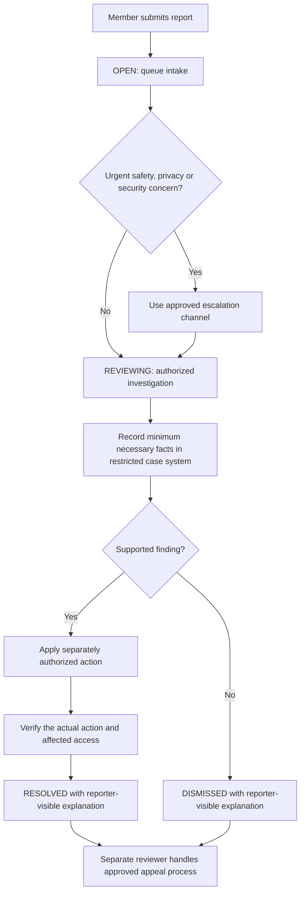

# Content operations: launch review draft

**Status:** prepared for review on 17 October 2026. This is a proposed operating workflow for M08.4, not an approved policy or a staffed support commitment. M18.3 privacy/legal review remains a prerequisite.

Update, 18 October 2026: [the paginated web/native queue](MODERATION-QUEUE-2026-10-18.md) addresses the technical 200-report visibility limit. Operating-policy approval and staffing remain open.

## Existing product behavior

Signed-in members can report an account or content using `POST /api/moderation/reports` and see their submitted reports at `GET /api/moderation/reports/mine`. Supported reasons are harassment, spam, impersonation, privacy, illegal content and other. The API accepts up to 2,000 characters of details.

Administrators can list the most recent 200 reports and update a report to `OPEN`, `REVIEWING`, `RESOLVED` or `DISMISSED`, with notes. Updating a status records the moderator and timestamp. These status changes do not themselves remove content, suspend an account, notify a reporter, establish an appeal process or preserve a separate immutable decision history. The legacy list remains bounded. Current web/native clients use the new paginated queue endpoint; this still does not establish a complete case-management or appeal system.

Moderator notes are included in the reporter's response. Treat them as reporter-visible explanations; do not place internal investigations, another person's private details or legal advice in this field. Use an approved restricted case system for internal evidence if one is adopted.

Source: [moderation controller](../../backend/spring-boot-app/src/main/java/com/myaaptha/domain/moderation/ModerationController.java). Security scanner incidents have a separate [administrator API](../../backend/spring-boot-app/src/main/java/com/myaaptha/platform/security/SecurityReportsController.java); resolving an abuse report does not resolve a security incident.

## Proposed responsibility assignment

| Responsibility | Proposed accountable role | Required before launch |
|---|---|---|
| Queue ownership and coverage | Content operations lead | Named primary, backup and coverage hours |
| Report investigation and explanation | Authorized moderator | Access review and training with synthetic cases |
| Privacy requests and retention decisions | Privacy owner | Approved request process and retention schedule |
| Security incident response | Security on-call | Working alert route, escalation contacts and rehearsal |
| Legal escalation and preservation | Designated legal reviewer | Approved jurisdiction-specific procedure |
| Appeals and quality review | Reviewer distinct from the initial decision | Approved intake and review process |

These are role assignments to fill, not evidence that personnel or channels already exist. Do not publish response-time promises until coverage and escalation have been accepted.

## Proposed case workflow

The API currently permits any listed status update; this diagram describes the proposed operating sequence, not an enforced state machine. A case must not be marked resolved merely because a status update succeeded. Verify the underlying action separately.

## Review examples

| Example | Proposed handling | Closure evidence |
|---|---|---|
| Repeated unsolicited posts | Review the reported context, distinguish duplication from legitimate activity and apply an approved action | Action reference, verification and concise explanation |
| Impersonation allegation | Use approved identity-review steps; do not expose another account's private information | Reviewer decision and explanation without identity documents |
| Private contact details exposed | Escalate to the privacy owner and follow the approved restriction/removal process | Verified exposure restriction and privacy case reference |
| Suspicious attachment | Refer to the security incident workflow; do not download it to a normal workstation | Security case reference and confirmed containment |
| Disputed moderation decision | Route through the approved appeal channel to another reviewer | Appeal outcome linked to the original case |

## Launch acceptance checklist

- Assign named owners and backups, coverage hours, escalation routes and approved response targets.
- Approve published reporting, privacy, retention and appeal guidance. Define any preservation requirements with the authorized reviewer.
- Demonstrate member/admin access separation, reporter-visible notes and separate verification of enforcement actions using synthetic data.
- Rehearse the paginated queue and verify older open cases remain discoverable; approve queue ownership and reconciliation procedures before operational reliance.
- Decide whether immutable decision history and reporter notifications are required; they are not established by the current status endpoint.
- Rehearse one privacy case, one security escalation and one appeal. Record outcomes and reviewer approval.

This document prepares the review. It does not complete M08.4, M18.3 or public-launch approval.
