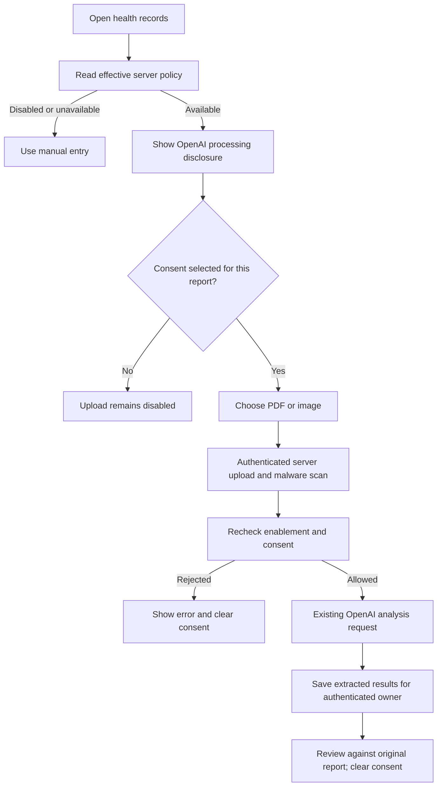

# Health analysis: consent and enablement

Engineering update: 17 October 2026. Launch gate: **M09.4 remains open** for provider, privacy, consent-language and budget acceptance.

## Behavior

Analysis now defaults to disabled, including when the general OpenAI API key is present. Enabling it requires both `MYAAPTHA_HEALTH_AI_ENABLED=true` and a configured server key. The switch is an operational control, not evidence of policy approval or a spend cap. Manual report entry remains available while analysis is disabled.

`GET /api/health/ai-status` returns effective availability, `consentRequired: true` and `provider: "OpenAI"`. It exposes no key. The web and native clients show the provider disclosure and require an explicit checkbox selection before choosing/uploading a report. Consent is cleared after an attempted upload, so another report requires a new selection.

`POST /api/health/reports/analyze` requires multipart `file` and `processingConsent=true`. Disabled processing returns 503. With processing configured, missing consent returns 400 before the analyzer reads the report or calls the provider. Consent does not bypass file validation or the server malware scanner. Only PDF, JPEG and PNG reports are accepted, within the existing 25 MB file limit.

Native sends the correct multipart MIME type and consent field. Web and native skip the stored-file retention prompt for analysis: this endpoint stores extracted report/measurement records, not the uploaded raw report as a diary file. This does not establish the external provider's retention policy; that must be reviewed separately. Existing diary upload retention controls remain in place.

## Activation acceptance still required

1. Approve processing purpose, provider handling/retention, disclosure language and applicable user rights with the authorized privacy reviewer.
2. Configure an approved provider project, credential scope, budget controls and alert ownership. This feature switch is not a billing cap.
3. Validate a consented synthetic report end to end, including extraction quality, ownership, failures, deletion guidance and alerts; record the reviewed artifact identity.
4. Complete physical-device checks, then deliberately enable the switch in the approved environment. Disable it to stop subsequent processing requests; already sent provider requests are not recalled by toggling the switch.

Local tests use synthetic fixtures. The browser enabled branch mocks the analysis endpoint rather than forwarding a provider request. No live extraction accuracy or real-provider acceptance is claimed by these tests.
