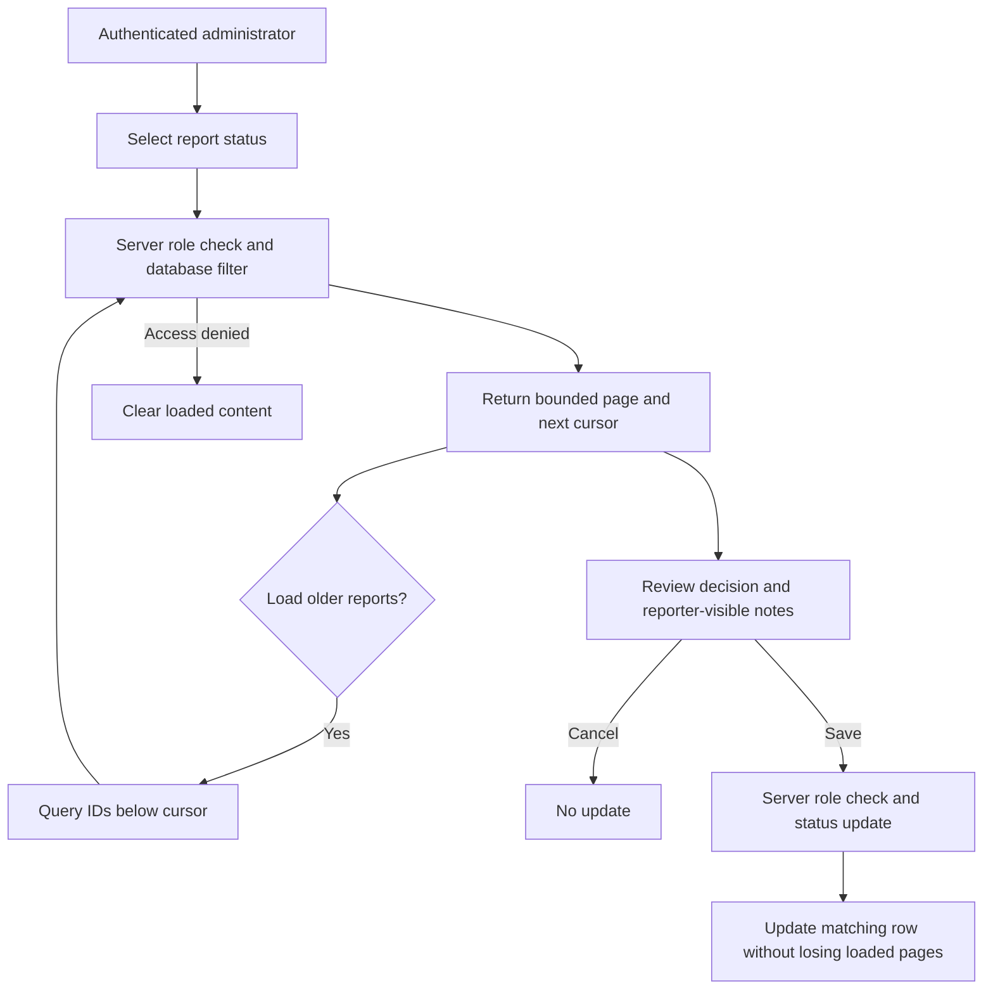

# Moderation queue engineering — 18 October 2026

This delivers the queue work identified during the content-operations review. It does not approve the operating policy, assign staff or establish a response-time commitment.

## Shared contract

Authenticated administrators use `GET /api/moderation/reports/queue?status=OPEN&limit=50&beforeId=123`. The response contains `items` and `nextCursor`; a null cursor means there are no more matching records. Omit `beforeId` to refresh from the newest report. Limits must be 1–100; cursors must be positive. Status is `OPEN`, `REVIEWING`, `RESOLVED`, `DISMISSED` or `ALL`.

Filtering occurs in the database before the page limit. Results are ordered by descending report ID. New reports arriving after the first page do not shift subsequent cursor pages; refresh explicitly to see them. The V69 migration adds a matching `(status, id DESC)` index. The legacy array endpoint remains available for older clients with its original 200-record limit; current web/native queues use the new endpoint.

## Client behavior

- Both clients load older reports and reset the cursor when the status filter changes. Loaded counts describe the records on screen, not a total count of the entire queue.
- Native now supports the existing review/resolve/dismiss actions, with reporter-visible notes. Web and native cancel without submitting when the notes dialog is cancelled.
- Successful updates replace or remove the affected row locally rather than resetting pagination. Authorization denial clears loaded report content and the cursor.
- Status changes do not delete content, suspend accounts or send reporter notifications. Existing policy/retention/appeal requirements remain open.

## Evidence and scope

The isolated database suite exercises more than 200 reports, new arrivals between pages, filtering before limits, invalid bounds, ordinary-member denial and reporter ownership. HTTP checks verify query binding and response shape. Native widget checks cover pagination, filter reset, cancellation, saved notes and access-denial cleanup.

Browser acceptance uses a normal synthetic account to verify real queue denial. Administrator UI branches use synthetic route responses, without promoting any live account. This tests client behavior; the real administrator query is covered by the isolated backend suite.

This newly identified engineering deliverable is tracked separately as **M08.5**. It adds one task to the original 86-task scope. **M08.4 operating-policy approval remains pending**; its technical queue limit is addressed without treating staffing or policy approval as completed.
