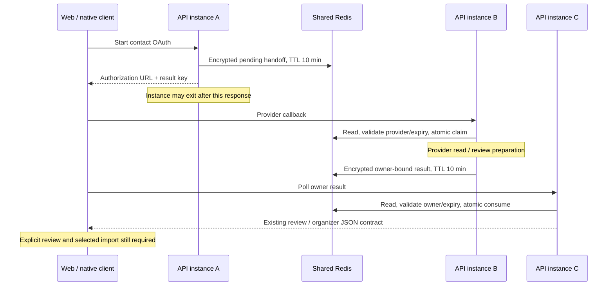

# Contact OAuth shared storage

Date: 19 October 2026. Launch gate: M04.4 (provider/staging acceptance remains open).

`ContactOAuthService` now stores pending authorizations and review results through
`ContactOAuthStateStore` and the configured `EphemeralState` provider. It no longer
owns process-local pending/result maps. Web and native endpoints and JSON contracts
remain the same; a successful review still requires explicit selected-contact saving.

| Boundary | Behavior |
|---|---|
| Shared provider | Select `myaaptha.state.provider=redis`; all API replicas use the same Redis namespace and encryption key ring. |
| Development fallback | Memory remains a bounded development-only option. It does not survive process exit and does not share state between replicas. |
| Encryption | Redis OAuth storage refuses startup with field encryption disabled. AES-GCM protects payloads using the existing versioned field key ring. OAuth rejects plaintext even if another field migration permits legacy reads. |
| Key privacy | Redis keys contain purpose plus SHA-256 of the random opaque token, without account/email/contact names. |
| Binding | Encrypted envelopes include version, purpose and exact storage key; copying a valid ciphertext to another key/purpose fails validation. |
| Retention | Pending and completed results each have a ten-minute TTL. An envelope expiry also protects reads when backend retention exceeds its deadline. Memory idle cleanup remains enabled. |
| Limits | Each serialized envelope is capped at 20 MiB before encryption; oversized previews become a terminal review error rather than being truncated, saved or left polling. |
| Ownership | Another account receives 404 without consuming the owner's result. A wrong-provider callback leaves the pending authorization available for its correct callback. |
| Replay | Atomic compare/delete removes the precise validated encrypted snapshot; one concurrent consumer wins. |
| Failure | Missing/expired/read results return 404; terminal organizer failures retain HTTP 422. Oversized writes raise 413 internally and the callback publishes a small terminal failed review (organizer HTTP 422). Corrupt, mismatched or unavailable storage returns a safe 503 without private error details or a local-memory fallback. |

Pending storage omits the email/login hint and unused organization flag; email is
used only to construct the provider authorization URL. Provider access tokens and
authorization codes are not persisted by this store. PKCE verifiers and contact
previews are encrypted when using Redis.

The subprocess regression starts a synthetic flow in one JVM, exits it, invokes a
denied callback in a second JVM, consumes its owner-bound terminal result in a third
JVM, then rejects replay in a fourth. All use an isolated local Redis namespace and
synthetic credentials. No Google/Microsoft token exchange or real-user import is
performed. Other tests use mock provider HTTP responses and verify private-book
JSON, pagination/group/phone preservation, ownership, tampering, expiry, size limits,
concurrency, unavailable storage, encryption and consent revocation.

## Rollout and remaining acceptance

All replicas must use compatible code, namespace and key rings. The old release's
process maps are not migrated: drain outstanding old flows or allow their ten-minute
window to expire before routing callbacks across mixed versions. Retain old decryption
keys for in-flight handoffs when rotating the active key.

This is an ephemeral handoff, not a durable workflow. A crash after atomic callback
claim but before publishing its result requires the user to start again. Redis data
loss, eviction, outage or inconsistent configuration can invalidate flows; this code
does not establish a Redis persistence/HA/RPO guarantee. It does not revoke provider
grants or guarantee interruption of already-running external calls after client cancel.

Real provider registrations, callback URLs/scopes, credentials, provider consent,
physical devices and exact staging deployment remain unaccepted. Local Redis/JVM
evidence does not close M04.4 or authorize public launch.
