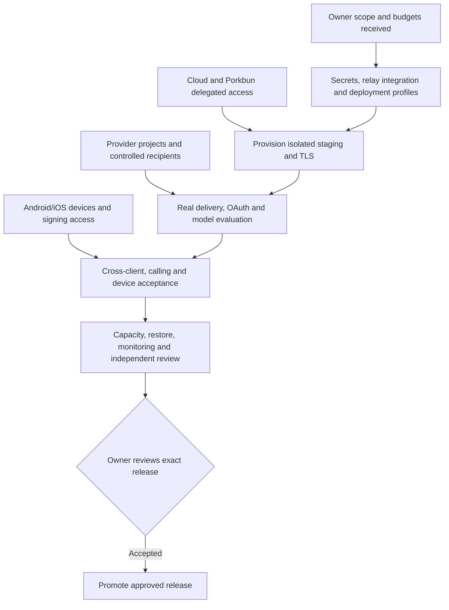

# Owner response processed — 26 October 2026

Your edited dependency file has been read and preserved. Its answers are captured in `owner-launch-inputs-2026-10-26.json`, with confirmed decisions separated from recommendations and approvals. Reconciliation detects later edits by checking the source-file hash.

## Decisions received

CPET Solutions Pvt. Ltd., India; preferred India hosting; approximately ₹6,000/month infrastructure, ₹20,000 setup and ₹3,000/month AI; launch target 9 November 2026. Health analysis and both audio/video calls remain launch requirements. Manager owns privacy/support, CTO owns moderation/emergency-document policy, and the project owner approves release. Google Play ownership is CPET Solutions; Apple ownership is the project owner.

“180 days” has not been applied to automatic deletion: active-file expiry and retention of deleted versions are different operations. A clarification has been requested. The combined “1 day” RPO/RTO answer is provisionally represented as 24 hours for each, subject to an actual recovery drill.

## Work completed from these inputs

- Generated and validated five application-owned secrets: database password, cache password, JWT signing secret, field-encryption key and MFA-encryption key. Existing valid values are preserved. A separate relay signing secret and Redis TLS configuration were prepared. Values are not printed or committed. The local secret directory is restricted to the owner account and Windows SYSTEM. A protected backup/vault handoff is still required before using these keys for production data.
- Added an authenticated, non-cacheable ICE configuration API. It issues account-specific, expiring Coturn REST credentials without sending the shared signing secret to clients. Both web and Flutter obtain the same configuration. When relay-required mode is enabled, missing relay configuration returns an error rather than silently claiming reliable calling.
- Prepared an optional protected integration configuration mount. Provider keys can be supplied through config-tree files rather than committed environment values.
- Prepared a single-host PostgreSQL/Redis deployment overlay that retains database TLS verification, cache TLS and private database/cache ports. It requires actual certificates, immutable images and provisioning; it is not a running cloud environment.
- Prepared Coturn deployment/configuration templates and a renderer that validates IP assignments, rejects injected secrets and refuses to overwrite a configuration. The relay template requires authentication/TLS, blocks private/metadata peer destinations and limits allocations/bandwidth. It still needs the instance IPs, DNS and issued certificates.
- Added a repeatable owner/budget reconciliation report. No cloud account is contacted or provisioned by this tool, and it never grants release approval.

## Hosting recommendation and budget

Recommend **AWS Lightsail in Mumbai (`ap-south-1`), 8 GB RAM**, with PostgreSQL/Redis on the same host and private S3 storage in Mumbai. This is an initial single-host deployment, with a single point of failure and operator-managed backup/recovery. Representative load and recovery tests are required; it is not a capacity guarantee for 100 or 2,000 concurrent users.

| Initial planning item | Assumed monthly USD |
|---|---:|
| Lightsail Linux/public-IPv4 instance, 8 GB RAM / 2 vCPU | 44.00 |
| 100 GB active S3 objects at $0.025/GB | 2.50 |
| 100 GB aggregate backup/noncurrent objects, same planning rate | 2.50 |
| 20 GB billed snapshot storage at $0.05/GB | 1.00 |
| 10,000 outbound SES emails, à la carte, excluding attachment traffic | 1.00 |
| DNS allowance | 0.50 |
| **Baseline** | **51.50** |

At a **planning** conversion of ₹95/USD and an 18% tax allowance, this is **₹5,773.15/month**, leaving only ₹226.85 against ₹6,000. These are explicit assumptions, not a current exchange-rate quote or a guaranteed bill. Storage requests, internet egress, SMS, additional staging resources, domain renewal, store/runner fees and independent reviews are excluded. AI has its separate ₹3,000 budget. Provider discounts/free credits are not assumed.

Storage quota is not actual consumption. Filling 1 GB for each of 1,000 users, plus the modeled recovery/version storage, raises the same baseline to **₹10,817.65/month** before the exclusions. Growth to 20,000 users or 10 GB tiers needs a new capacity/storage budget. Do not treat this initial plan as three years of fixed-price capacity.

Rates checked against [Lightsail pricing](https://aws.amazon.com/lightsail/pricing/), the [AWS Mumbai S3 price list](https://pricing.us-east-1.amazonaws.com/offers/v1.0/aws/AmazonS3/current/ap-south-1/index.json), and [SES à la carte pricing](https://aws.amazon.com/ses/pricing/). Mumbai has half the headline Lightsail transfer allowance: the 8 GB plan's listed 5 TB becomes 2.5 TB there. Additional transfer can still incur charges.

The budget profile assumes self-managed database/cache. The original production Compose file alone expects managed services; combine the single-host overlay and supply its TLS prerequisites when provisioning. Daily logical backups alone are not PITR acceptance: WAL/PITR setup, isolation and a measured restoration remain engineering work after infrastructure access exists.

## Provider and application choices

| Area | Recommendation / next engineering action |
|---|---|
| Domain/DNS | Keep Porkbun DNS unless deliberately migrating it. Prepare `www`, `staging` and `turn` records for assigned instance addresses. Use the same `/api` origin as the web app. |
| Email | SES SMTP from verified `myaaptha.com` identities; propose `no-reply@`, `support@`, `privacy@` and `security@` aliases. Mailboxes/forwarding, DKIM and sender/domain verification must actually be created. The current generic notification webhook does not itself provision an SES/FCM gateway. |
| Push | Firebase Cloud Messaging; [FCM is listed as no-cost](https://firebase.google.com/pricing). Supply the actual project/service account and controlled device token; iOS also requires APNs setup. No push project was created. |
| SMS | Preserve your planned API. Need its provider name, API specification and protected credential reference before selecting/adapting it. Existing phone verification uses Twilio Verify; an unrelated SMS API is not automatically interchangeable. |
| Google contacts | Register a web OAuth app with read-only contacts scope; exact callback `https://www.myaaptha.com/api/contact-organizer/oauth/callback/google`. Register the separate staging callback under `https://staging.myaaptha.com`. |
| Microsoft contacts | Register Microsoft Entra app with the scopes currently used by the application: `openid profile https://graph.microsoft.com/Contacts.Read`. Production callback ends `/api/contact-organizer/oauth/callback/microsoft`; add the staging equivalent. |
| Calling | Self-host Coturn in the selected India environment. Use short-lived API-issued credentials. Test audio/video over Wi-Fi, mobile data, restrictive NAT, denial/revocation and network switching. Current credential lifetime is bounded to one hour; long-call renewal and reconnection require acceptance testing. |
| Mobile identity | Propose `com.myaaptha.app` for new Android/iOS store registrations, subject to availability/ownership. Existing development IDs have not been silently changed, avoiding an unexpected debug-app identity migration. |
| Devices | Use an existing midrange Android plus a lower-memory/older supported Android and a borrowed supported iPhone. ADB currently reports **zero connected devices**. Connect/authorize an Android device for engineering testing. No hardware purchase is included in the setup estimate. |
| iOS | A macOS/Xcode runner is required. A hosted macOS runner can replace an owned Mac, but Apple team, signing/provisioning and actual device validation are still needed. |

Public DNS lookup on 26 October returned Porkbun nameservers (`curitiba`, `fortaleza`, `maceio`, `salvador`) and a `www` parking alias to `pixie.porkbun.com`. The submitted `ns1`/`ns2` names are not DNS-administration credentials or a container-registry namespace. No records were changed.

Google Play lists a [$25 registration fee](https://support.google.com/googleplay/android-developer/answer/6112435). Apple lists [program enrollment requirements](https://developer.apple.com/programs/enroll/). Account verification, signing and review cannot be completed with an organization label alone. Store submission and production promotion still require approval of the final artifacts.

## AI and health plan

Evaluate **GPT-6 Luna** for routine application help and **GPT-6.1 Sol** as a stronger comparison candidate. Current standard rates are $0.10/$0.50 and $2/$10 per million input/output tokens respectively, according to [official OpenAI pricing](https://developers.openai.com/api/docs/pricing). [Luna is positioned for focused high-volume tasks](https://developers.openai.com/api/docs/models/gpt-6-luna). These are evaluation recommendations; runtime model defaults were not silently migrated.

Propose splitting the ₹3,000 envelope into ₹1,200 help, ₹1,200 health extraction/evaluation, ₹300 comparative testing and ₹300 reserve. Set provider alerts before running a limited synthetic evaluation. Provider budget alerts and the existing request-per-minute control are not a guaranteed monetary hard cap. No paid model calls were made.

Use synthetic or properly de-identified reports for engineering tests. App data storage in India does not imply every AI request is processed in India: [OpenAI's data controls](https://developers.openai.com/api/docs/guides/your-data) distinguish storage from processing, show India processing limitations, and describe endpoint-specific retention and eligibility controls. The Manager/privacy owner must review the actual account configuration and disclosure. A qualified clinical reviewer should assess extraction accuracy, units, reference ranges, missing values and ambiguous scans; AI output is not approved clinical advice. Keep raw source comparisons and explicit per-report consent in the acceptance evidence.

Health analysis remains required in the plan, but is not automatically activated merely because the requirement is now confirmed. Live provider configuration, privacy/consent acceptance, quality review and device testing remain prerequisites. Manual health entry remains available.

## Operating policy and launch sequence

The supplied Manager/CTO assignments replace generic role placeholders in the owner plan. Still needed: actual contact addresses, coverage/backup staff, an appeal reviewer distinct from the original moderation decision, an independent security reviewer and a clinical quality reviewer. Engineering can prepare evidence and remediation but cannot self-approve independence or clinical quality.

Recommended emergency-document scope for review: only documents explicitly selected by their owner, purpose-limited access, a short grant window and revocation/audit controls. CTO must decide eligible categories and actual windows; a role title alone is not that decision. Retention changes remain pending clarification and review.

Work toward 9 November: infrastructure/provider setup first, then real delivery/OAuth/health/calling tests, then recovery/capacity/security review and a release decision. If required gates are incomplete, propose a controlled web/Android pilot for owner consideration; do not silently defer the requested health/calling scope or claim a public/store launch is approved.

## Exact next inputs

Edit [the shortened remaining-input file](MYAAPTHA-REMAINING-INPUTS-2026-10-26.txt). It requests account access and concrete references, not another confirmation of each of the 29 tasks. Development, integration and test execution remain engineering responsibilities.

## Final local verification

7 backend relay tests, 8 native tests, 29 infrastructure tests and 2 desktop/mobile browser tests passed. Authenticated live HTTP returned 200 with no-store; anonymous access returned 401. Backend, production web and Android debug builds passed. The served APK hash and embedded LAN API address match the new build. These checks use local/synthetic fixtures and do not establish real relay delivery, physical-device acceptance or production readiness. See [verification record](owner-input-verification-2026-10-26.json).
