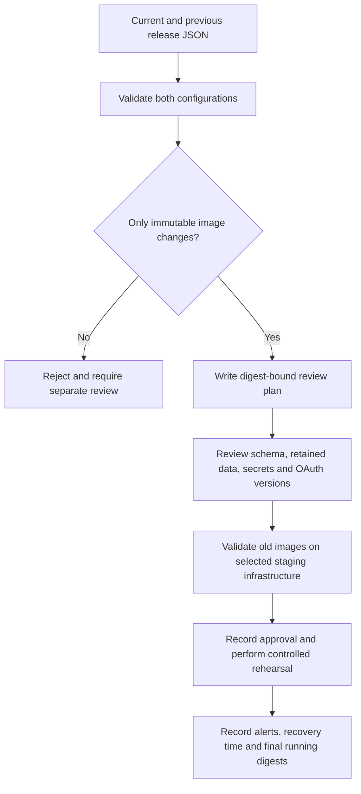

# Offline rollback review plan

Date: 20 October 2026. Related launch gate: M15.7.

`infrastructure/plan_rollback.py` compares the current and previous non-secret
release configuration files. Both must pass the existing release validator,
including immutable image digests, placeholder rejection and database connection
budgets. The command never contacts Kubernetes, registries or a cloud provider.

```powershell
python infrastructure/plan_rollback.py current-release.json previous-release.json --output rollback-plan.json
```

Exit 0 means a plan was written; exit 2 means rejection. Do not reuse an existing
output after a failed invocation. Input configurations must contain no credentials.
The planner refuses to overwrite either input, including through an existing hard
link. It normalizes documented resource defaults and requires all non-image settings
to match. Changed database/Redis/storage/routing/resource settings, newly introduced
settings and removed settings require separate review. It does not echo their values.

The JSON lists each changed deployment with its current and previous image digest,
hashes both effective configurations, and includes operational review steps. Its
`releaseApproved` and `clusterContacted` values are always false; schema compatibility
is unverified and live rehearsal is pending. A no-op with identical images is rejected.



The tool does not prove that the current configuration is deployed, that a digest
exists or is trusted, or that older code can read the current database. It does not
reverse migrations, revert secrets, modify data, execute rollout commands or grant
approval. For shared OAuth, review key-ring/version compatibility and drain older
process-local handoffs as documented in the [storage rollout guide](OAUTH-SHARED-STORAGE-2026-10-19.md).

M15.7 remains open until actual monitoring, recipient routes and rollback rehearsal
are accepted on selected infrastructure. A generated plan is preparation for that
review, not evidence that the live gate has passed.
