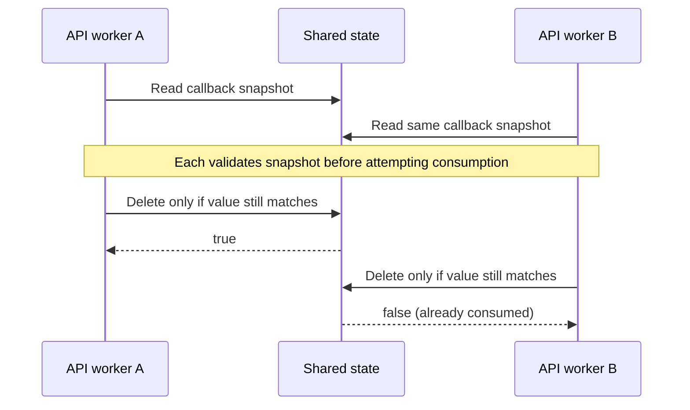

# Shared-state consumption prerequisite

Date: 18 October 2026. Related launch gate: M04.4.

The shared ephemeral-state interface now supports `deleteIfValue(key, expectedValue)`.
Callers can read a value, validate its owner/provider and expiry, then remove precisely
that validated value. An ordinary get followed by an unconditional delete would allow
two workers to consume the same callback, or a stale worker to delete a replacement.

Redis executes the comparison and deletion in one Lua operation against a namespaced
key. The local fallback performs both under its existing monitor. Missing, expired or
different values return false. Null expected values are rejected; Redis failures throw
instead of reporting success. The operation does not itself validate ownership: its
caller must perform that validation before attempting removal.

The development memory fallback also prunes expired entries every minute, even
without subsequent reads. Its 20,000-entry bound is preserved. Redis uses its native
TTL expiration. Neither provider is a durable source of record or a transactional
guarantee for downstream external calls.

Verification covers competing consumers, wrong/stale snapshots, replacement
preservation, missing/expired values, null rejection, unavailable Redis and idle local
cleanup. The Redis test uses two independent clients against a disposable local
instance, synthetic values and a unique namespace. Contact OAuth regression tests
remain part of the targeted suite.

**This is a prerequisite, not a completed OAuth storage migration.** The existing
contact service still holds pending authorizations/results in its own process maps.
Moving those records requires encrypted serialization, owner/provider validation,
bounded retention, cross-instance callback/result tests and restart acceptance.
Real provider configuration, physical-device and staging acceptance also remain
open. M04.4 stays pending; completed launch-task totals do not increase.

## Superseding implementation ? 19 October

The service-map limitation above describes the 18 October prerequisite release. Contact OAuth now uses that atomic operation through its configured shared store. See [19 October storage implementation and acceptance boundaries](OAUTH-SHARED-STORAGE-2026-10-19.md); memory mode is still development only.
